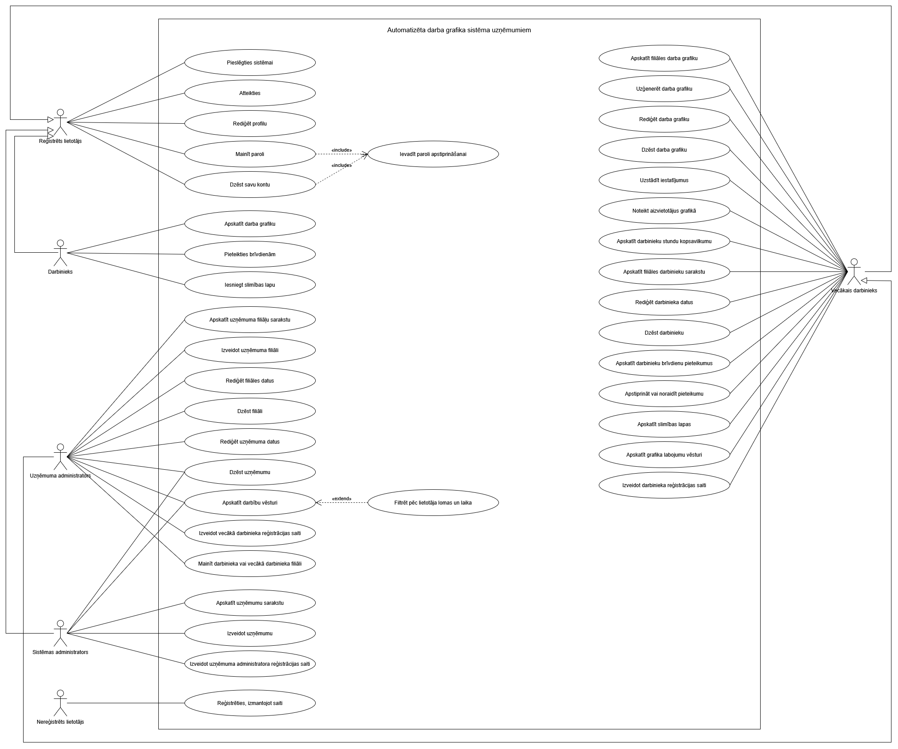
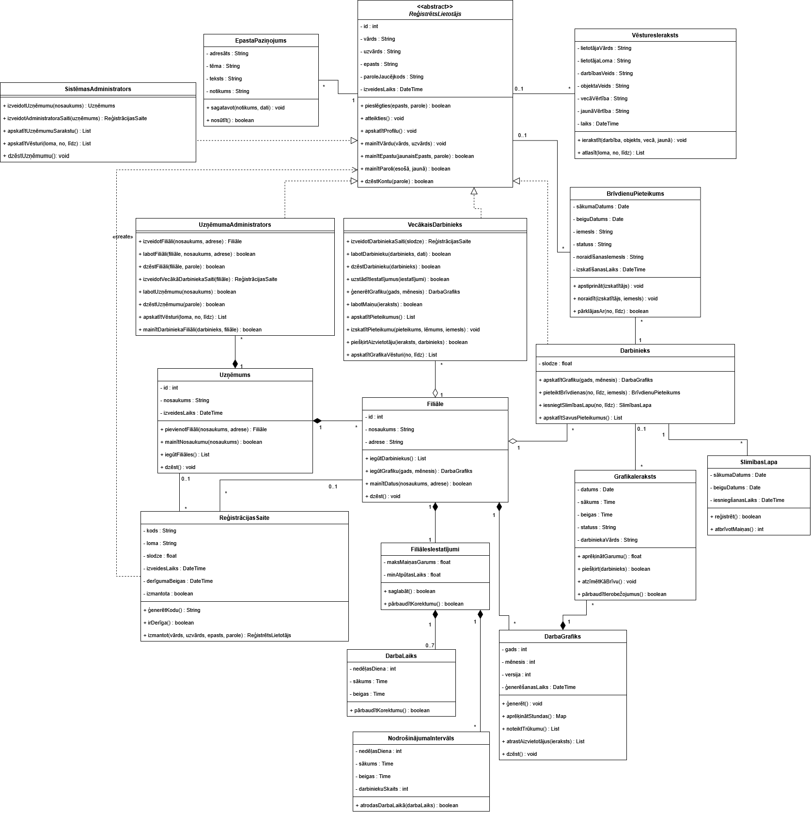

# Automatizēta darba grafika sistēma uzņēmumiem

*Noslēguma darbs (projekta dokumentācija). Konvertēts no `documentation.docx`; oriģinālais satura rādītājs aizstāts ar sarakstu zemāk.*

**RĪGAS VALSTS TEHNIKUMS** · DATORIKAS NODAĻA  
Izglītības programma: Programmēšana · Moduļa “Datu bāzu tehnoloģijas”  
Aleksandrs Kļimanovs · Rīga · 2026./2027. m.g.

## Saturs

- IEVADS
- 1. UZDEVUMA NOSTĀDNE
  - 1.1. Ieejas un izejas informācijas apraksts
    - 1.1.1. Ieejas informācijas apraksts
    - 1.1.2. Izejas informācijas apraksts
  - 1.2. Funkcionālās prasības
    - 1.2.1. Reģistrācija un autorizācija
    - 1.2.2. Lietotāja profila pārvaldība
    - 1.2.3. Uzņēmumu pārvaldība
    - 1.2.4. Filiāļu pārvaldība
    - 1.2.5. Reģistrācijas saišu pārvaldība
    - 1.2.6. Darbinieku pārvaldība
    - 1.2.7. Filiāles grafika iestatījumu pārvaldība
    - 1.2.8. Darba grafika ģenerēšana
    - 1.2.9. Darba grafika apskate un rediģēšana
    - 1.2.10. Vēlamo brīvdienu pieteikumi
    - 1.2.11. Slimības lapas
    - 1.2.12. Brīvo maiņu aizvietošana
    - 1.2.13. Piekļuves tiesības un datu apjoms
    - 1.2.14. E-pasta paziņojumi
    - 1.2.15. Piekļuves tiesības un datu apjoms
    - 1.2.16. Datu integritāte un kļūdu apstrāde
    - 1.2.17. Datu izgūšana un apstrāde
  - 1.3. Nefunkcionālās prasības
  - 1.4. Sistēmas lietotāji un to mijiedarbība ar sistēmu
    - 1.4.1. Nereģistrēta lietotāja iespējas
    - 1.4.2. Reģistrēta lietotāja iespējas
    - 1.4.3. Darbinieka iespējas
    - 1.4.4. Vecākā darbinieka iespējas
    - 1.4.5. Uzņēmuma administratora iespējas
    - 1.4.6. Sistēmas administratora iespējas
  - 1.5. Datu bāzes plānotais saturs
  - 1.6. Lietotāju tipisko darbību scenāriji
    - 1.6.1. Scenārijs “Reģistrācija pēc saites”
    - 1.6.2. Scenārijs “Darba grafika ģenerēšana”
    - 1.6.3. Scenārijs “Brīvdienu pieteikšana un izskatīšana”
    - 1.6.4. Scenārijs “Slimības lapa un aizvietošana”
- 2. SISTĒMAS KONCEPCIJAS IZVĒRTĒJUMS
  - 2.1. SVID analīze
  - 2.2. Secinājumi un attīstības perspektīvas
- 3. DATU BĀZES SISTĒMAS PROJEKTĒŠANA
  - 3.1. Objektorientēts konceptuālais datu modelis
    - 3.1.1. Klašu funkcijas un nozīme sistēmā
    - 3.1.2. Klašu savstarpējās attiecības
- PIELIKUMI
  - Lietošanas gadījumu (USE CASE) diagramma
  - UML klašu diagrammā

# IEVADS

Mazumtirdzniecībā darbs notiek maiņās, un veikalam katrā dienas daļā ir nepieciešams noteikts darbinieku skaits. Tāpēc darba grafika sastādīšana ir regulārs un laikietilpīgs uzdevums. Tajā jāņem vērā darbinieku slodzes (pilna, divas trešdaļas vai puse), mēneša stundu norma, summētais darba laiks, atpūtas prasības un darbinieku vēlmes par brīvdienām.

Tirgus izpēte parādīja, ka praksē grafiku bieži sastāda manuāli Excel tabulā. Piemēram, vienā no lielākajiem mazumtirdzniecības veikaliem Latvijā, pēc veikala darbinieka vārdiem, grafiku kasieriem sastāda vecākais kasieris. Tabula glabā datus, bet nepārbauda ierobežojumus, tāpēc kļūdas (nepietiekams darbinieku skaits maiņā, atpūtas laika pārkāpumi) atklājas tikai pēc grafika sastādīšanas. Vecākais darbinieks savu darba laiku tērē grafikam, nevis tiešajiem pienākumiem, bet darbinieki grafiku var uzskatīt par netaisnīgu.

Tirgū ir universālas grafiku vadības sistēmas: Planday, Deputy un Shiftbase. Tās ir pilnapjoma darbaspēka vadības risinājumi, kuros maksa tiek noteikta par katru lietotāju. Automātiskā grafika sastādīšana dažās no tām ir pieejama tikai augstākajā tarifā vai agrīnajā piekļuvē, un Latvijas Darba likuma prasību atbalsts nav apstiprināts. Tāpēc ir pamatota sistēma ar šauru funkcionālo fokusu: tā risina tikai grafika sastādīšanu un ar to saistīto brīvdienu un aizvietošanas uzskaiti.

Sistēmas mērķis ir automatizēt ikmēneša darba grafika sastādīšanu, ievērojot darbinieku slodzes, mēneša stundu normu, summēto darba laiku un atpūtas prasības, kā arī nodrošināt vienotu vidi grafika izveidei, vēlamo brīvdienu un slimības gadījumu uzskaitei un aizvietotāja izvēlei. Sistēma tiek veidota universāla, ar jēdzienu “darbinieks”, lai to varētu izmantot jebkurā uzņēmumā ar maiņu darbu.

Mērķauditorija ir mazumtirdzniecības uzņēmumi ar maiņu darbu. Sistēmā ir četras lietotāju lomas:

1. *uzņēmuma administratori* — pārvalda uzņēmuma filiāles, reģistrē vecākos darbiniekus un nepieciešamības gadījumā paši var labot grafiku;
2. *vecākie darbinieki* — sastāda grafiku, apstiprina vēlamās brīvdienas un izvēlas aizvietotāju slimības gadījumā; viņiem nepieciešams ātrāks process un automātiska stundu aprēķināšana;
3. *darbinieki *— iesniedz vēlamās brīvdienas un slimības informāciju, un jebkurā laikā redz savu grafiku;
4. *sistēmas administrators* — pārvalda uzņēmumu sarakstu, izveido uzņēmumus un uzņēmuma administratoru reģistrācijas saites, kā arī apskata visu uzņēmumu darbību vēsturi.

Sistēmas paredzamie ieguvumi ir mazāks grafikam veltītais laiks, mazāk kļūdu, caurskatāma brīvdienu apstiprināšana, aizvietotāja ieteikšana un grafika labojumu vēsture.

# 1. UZDEVUMA NOSTĀDNE

Noslēguma darba uzdevums ir izveidot datu bāzes sistēmas koncepciju un prototipu automatizētai darba grafika sastādīšanai uzņēmumiem, kuros darbs notiek maiņās. Sistēma ļauj sastādīt ikmēneša darba grafiku pēc nepieciešamā darbinieku skaita dažādos dienas laikos, ievērojot darbinieku slodzes, mēneša stundu normu, summēto darba laiku un atpūtas prasības.

Sistēma glabā un apstrādā datus par uzņēmumiem, to filiālēm, lietotājiem un lomām, darbiniekiem un viņu slodzēm, vēlamajām brīvdienām, slimības lapām, grafika iestatījumiem un grafika ierakstiem ar labojumu vēsturi. Datu izguve un apstrāde ietver darbinieka nostrādāto stundu summas aprēķinu mēnesī un salīdzināšanu ar normu (darba dienu skaits, reizināts ar 8 stundām un slodzes daļu), trūkstošo stundu noteikšanu attiecībā pret nepieciešamo darbinieku skaitu, aizvietotāju kandidātu atlasi pēc mēnesī ieplānoto stundu skaita, kā arī darbību vēstures filtrēšanu pēc lietotāja lomas un laika.

## 1.1. Ieejas un izejas informācijas apraksts

### 1.1.1. Ieejas informācijas apraksts

Sistēmā tiks nodrošināta šāda ieejas informācija, ko ievada lietotājs.

1. Informācija par **lietotājiem** sastāvēs no šādiem datiem.
- Vārds un uzvārds – lietotāja vārds un uzvārds – burtu teksts ar izmēru līdz 100 rakstzīmēm (piem. Marta Vēberste).
- E-pasts – lietotāja e-pasta adrese – burtu teksts ar izmēru līdz 100 rakstzīmēm (piem. marta.veberste@gmail.com).
- Parole – parole, ar kuru lietotājs autorizējas sistēmā – burtu teksts ar izmēru līdz 30 rakstzīmēm (piem. Veberste123!).
- Loma – lietotāja loma sistēmā – burtu teksts ar izvēli: ‘Sistēmas administrators’, ‘Uzņēmuma administrators’, ‘Vecākais darbinieks’, ‘Darbinieks’. Lomu nosaka reģistrācijas saite, un lietotājs to neievada.
2. Informācija par **uzņēmumiem** sastāvēs no šādiem datiem.
- Nosaukums – uzņēmuma nosaukums – burtu teksts ar izmēru līdz 255 rakstzīmēm (piem. SIA Veikals).
3. Informācija par **filiālēm** sastāvēs no šādiem datiem.
- Nosaukums – filiāles nosaukums – burtu teksts ar izmēru līdz 255 rakstzīmēm (piem. Rīgas centra filiāle).
- Adrese – filiāles adrese – burtu teksts ar izmēru līdz 255 rakstzīmēm (piem. Brīvības iela 10, Rīga).
4. Informācija par **reģistrācijas saitēm** sastāvēs no šādiem datiem.
- Loma – lomas, kurai tiek izveidota saite – burtu teksts ar izvēli: ‘Uzņēmuma administrators’, ‘Vecākais darbinieks’, ‘Darbinieks’.
- Uzņēmums – uzņēmums, kuram lietotājs tiks piesaistīts (obligāts uzņēmuma administratora saitei) – vesels skaitlis, kas identificē uzņēmumu (piem. 3).
- Filiāle – filiāle, kurai lietotājs tiks piesaistīts (obligāta vecākā darbinieka un darbinieka saitei) – vesels skaitlis, kas identificē filiāli (piem. 3).
- Slodze – darbinieka darba laika daļa, norāda tikai darbinieka saitei – reāls skaitlis no 0 līdz 1 (piem. 0.5).
5. Informācija par **filiāles darbiniekiem** sastāvēs no šādiem datiem.
- Filiāle – filiāle, kurai lietotājs ir piesaistīts – vesels skaitlis, kas identificē filiāli (piem. 3).
- Slodze – darbinieka darba laika daļa, norāda tikai darbiniekiem, nevis vecākajiem darbiniekiem – reāls skaitlis no 0 līdz 1 (piem. 0.5 nozīmē pusslodzi).
6. Informācija par **filiāles grafika iestatījumiem** sastāvēs no šādiem datiem.
- Nedēļas diena – diena, kurai attiecas iestatījums – vesels skaitlis no 1 līdz 7 (piem. 1 – pirmdiena).
- Filiāles darba sākums un beigas – laiks, kad filiāle sāk un beidz darbu – simbolu virkne formātā HH:MM (piem. 08:00, 22:00).
- Intervāla sākums un beigas – dienas laika intervāls, kuram norādīts nepieciešamais darbinieku skaits – simbolu virkne formātā HH:MM (piem. 08:00, 12:00).
- Nepieciešamais darbinieku skaits – darbinieku skaits norādītajā intervālā – vesels skaitlis (piem. 3).
- Maksimālais maiņas garums – stundu skaits vienā maiņā – reāls skaitlis (piem. 12).
- Minimālais atpūtas laiks starp maiņām – stundu skaits – reāls skaitlis (piem. 12).
7. Informācija par **darba grafika ierakstiem** (labojot grafiku manuāli) sastāvēs no šādiem datiem.
- Darbinieks – darbinieks, kuram ieraksts attiecas – vesels skaitlis, kas identificē darbinieku (piem. 15).
- Datums – maiņas datums – datums formātā DD.MM.GGGG (piem. 12.11.2026).
- Maiņas sākuma un beigu laiks – simbolu virkne formātā HH:MM (piem. 09:00, 17:00).
8. Informācija par **vēlamajām brīvdienām** sastāvēs no šādiem datiem.
- Sākuma un beigu datums – vēlamo brīvdienu periods – datums formātā DD.MM.GGGG (piem. 20.11.2026, 22.11.2026).
- Iemesls – brīvdienu iemesls – burtu teksts ar izmēru līdz 255 rakstzīmēm, nav obligāts (piem. Ģimenes pasākums).
- Noraidīšanas iemesls – vecākā darbinieka norādītais iemesls, noraidot pieteikumu – burtu teksts ar izmēru līdz 255 rakstzīmēm, nav obligāts.
9. Informācija par **slimības lapām** sastāvēs no šādiem datiem.
- Sākuma un beigu datums – slimošanas periods – datums formātā DD.MM.GGGG (piem. 14.11.2026, 18.11.2026).
10. Informācija par **e-pasta maiņu** sastāvēs no šādiem datiem.
- Jaunais e-pasts – lietotāja e-pasta adrese – burtu teksts ar izmēru līdz 100 rakstzīmēm (piem. marta.veberste@gmail.com).
- Parole apstiprināšanai - parole, ar kuru lietotājs autorizējas sistēmā – burtu teksts ar izmēru līdz 30 rakstzīmēm (piem. Veberste123!).
11. Informācija par **grafika izvēli** sastāvēs no šādiem datiem.
- Mēnesis – vesels skaitlis no 1 līdz 12, piem. 11.
- Gads - vesels skaitlis, piem. 2026.
12. Informācija par **vēstures filtru** sastāvēs no šādiem datiem.
- Sākuma un beigu datums – datums formātā DD.MM.GGGG (piem. 14.11.2026, 18.11.2026).
- Loma - lietotāja loma, kas veica darbības – burtu teksts ar izvēli no četrām lomām vai ‘Visas’.

### 1.1.2. Izejas informācijas apraksts

Sistēma lietotājam attēlos šādu izejas informāciju.

1. **Uzņēmumu saraksts** (sistēmas administrators). Katram uzņēmumam tiek attēlots nosaukums un filiāļu skaits. Saraksts tiek attēlots pēc uzņēmuma nosaukuma alfabētiskā secībā.
2. **Filiāļu saraksts** (uzņēmuma administrators). Katrai filiālei tiek attēlots nosaukums, adrese un darbinieku skaits.
3. **Filiāles darbinieku saraksts** (vecākais darbinieks, uzņēmuma administrators). Katram darbiniekam tiek attēlots vārds, uzvārds, e-pasts, loma un slodze (tikai darbiniekiem).
4. **Darba grafiks (darbinieks, vecākais darbinieks, uzņēmuma administrators).** Grafiks tiek attēlots tabulā izvēlētajam mēnesim: rindās darbinieki, kolonnās mēneša dienas, šūnās maiņas sākuma un beigu laiks. Darbinieks redz visas filiāles darbinieku maiņas, bet dienas, kad kolēģis nestrādā brīvdienas vai slimības dēļ, viņam tiek atzīmētas vienādi kā ‘Nestrādā’. Vecākais darbinieks un uzņēmuma administrators redz arī iemeslu (‘Brīvdiena’ vai ‘Slimība’).
5. **Darbinieku stundu kopsavilkums** (vecākais darbinieks, uzņēmuma administrators). Katram darbiniekam tiek attēlota mēneša stundu norma (darba dienu skaits, reizināts ar 8 stundām un slodzi), grafikā ieplānoto stundu summa un starpība starp tām.
6. **Ziņojums par stundu trūkumu** (vecākais darbinieks, uzņēmuma administrators). Ja nepieciešamais darbinieku skaits kādā laika intervālā netiek nodrošināts, tiek attēlots datums, laika intervāls, nepieciešamais un ieplānotais darbinieku skaits.
7. **Aizvietotāju saraksts** (vecākais darbinieks). Pēc slimības lapas iesniegšanas vai brīvdienu apstiprināšanas, tiek attēloti darbinieki, kas attiecīgajā laikā nestrādā, sakārtoti pēc mēnesī ieplānoto stundu skaita augošā secībā.
8. **Vēlamo brīvdienu pieteikumi** (vecākais darbinieks, darbinieks). Vecākais darbinieks redz filiāles pieteikumu sarakstu: darbinieks, periods, iemesls un statuss (‘Gaida’, ‘Apstiprināts’, ‘Noraidīts’). Darbinieks redz savus pieteikumus ar statusu un noraidīšanas iemeslu. Darbinieks neredz kolēģu pieteikumus un to iemeslus.
9. **Darbību vēsture** (vecākais darbinieks, uzņēmuma administrators, sistēmas administrators). Sistēma glabā visu veikto darbību vienotu vēsturi. Katram ierakstam tiek attēlots lietotājs, viņa loma, darbības veids, objekts, vecā un jaunā vērtība (ja attiecas) un laiks. Vēsturi var filtrēt pēc lietotāja lomas un laika perioda. Piekļuve ir ierobežota: sistēmas administrators redz visus ierakstus, uzņēmuma administrators redz sava uzņēmuma ierakstus, bet vecākais darbinieks redz savas filiāles grafika rediģēšanas vēsturi (ierakstus par grafika labojumiem).
10. **Ziņojumi lietotājam.** Sistēma attēlo ziņojumus (skat. 1.1.2.1. tab.).
11. **E-pasta paziņojumi**. Sistēma nosūta lietotājiem e-pasta paziņojumus par notikumiem (skat. 1.1.2.2. tab.). Ja paziņojumu nevar nosūtīt, darbība tiek izpildīta, un kļūda tiek ierakstīta sistēmas žurnālā.

*1.1.2.1. tab. Ziņojumi lietotājam*

| **Situācija** | **Ziņojums** |
| --- | --- |
| Nepareizs e-pasts vai parole | “Nepareizs e-pasts vai parole” |
| Reģistrācijas saite nav derīga | “Reģistrācijas saite nav derīga” |
| E-pasts jau reģistrēts | “Šāds e-pasts jau ir reģistrēts” |
| Nav aizpildīti obligātie dati | “Aizpildiet visus obligātos laukus” |
| Grafiku nevar ģenerēt, jo nav iestatījumu | “Nav norādīti filiāles grafika iestatījumi” |
| Veiksmīga reģistrācija, saglabāšana vai dzēšana | “Reģistrācija veiksmīga”, “Dati saglabāti”, “Ieraksts dzēsts” |
| E-pasts nav ievadīts pareizajā formātā | "Nepareizs e-pasta formāts" |
| Parole nesastāv no 8–30 simboliem vai nesatur vismaz vienu burtu un ciparu | "Parole neatbilst prasībām" |
| Reģistrācijas mēģinājums ar saiti, kuras derīguma termiņš ir beidzies | “Reģistrācijas saites derīguma termiņš ir beidzies” |
| Paroles maiņas procesā pašreizēja ievadīta parole ir ievadīta nepareizi | “Pašreizējā parole nav pareiza” |
| Apstiprinot konta dzēšanu, tika ievadīta nepareiza parole | “Nepareiza parole” |
| Mēģinājums dzēst vienīgo uzņēmuma administratoru vai sistēmas administratoru | “Nevar dzēst vienīgo administratoru” |
| Lietotājs pieprasa e-pasta maiņu | "Apstiprinājuma saite nosūtīta uz jauno e-pastu" |
| Nav piekļuves tiesību | "Nav piekļuves tiesību" |
| Mēģinājums izveidot uzņēmumu ar jau esošu nosaukumu | “Uzņēmums ar šādu nosaukumu jau eksistē" |
| Mēģinājums izveidot filiāli ar jau esošu nosaukumu uzņēmumā | “Filiāle ar šādu nosaukumu šajā uzņēmumā jau eksistē” |
| Ievadīta slodze nav skaitlis no 0 līdz 1 | “Slodzei jābūt skaitlim no 0 līdz 1” |
| Reģistrācijas saite izveidota | “Reģistrācijas saite izveidota” |
| Mēģinājums dzēst lietotāju | “Vai tiešām dzēst lietotāju?” |
| Darba beigas ir agrāks par darba sākumu | “Darba sākumam jābūt agrākam par darba beigām” |
| Iestatījumu intervāls atrodas ārpus filiāles darba laika | “Intervālam jāatrodas filiāles darba laikā” |
| Vairāki intervāli pārklājas | “Intervāli nedrīkst pārklāties” |
| Nepareizi ievadīts darbinieku skaits | “Darbinieku skaitam jābūt veselam skaitlim, kas nav mazāks par 0” |
| Nepareizi ievadīts maiņas garums | “Maiņas garumam jābūt skaitlim no 0 līdz 24” |
| Nepareizi ievadīts atpūtas laiks | “Atpūtas laikam jābūt skaitlim, kas nav mazāks par 0” |
| Mēģinājums uzģenerēt grafiku pagājušam mēnesim | "Nevar ģenerēt grafiku pagājušam mēnesim" |
| Mēģinājums uzģenerēt grafiku, kad vēl nav pievienoti darbinieki | “Filiālē nav darbinieku” |
| Neizdevās uzģenerēt grafiku | “Grafiku neizdevās uzģenerēt” |
| Mēģinājums uzģenerēt grafiku, kad to rediģē cits lietotājs | “Grafiks šobrīd tiek mainīts” |
| Mēģinājums uzģenerēt grafiku ar rokas labojumiem | “Grafiks šim mēnesim jau eksistē, un rokas labojumi tiks zaudēti. Vai pārrakstīt?” |
| Grafiks mēnesim vēl nav izveidots | “Šim mēnesim grafiks vēl nav izveidots” |
| Mēģinājums labot pagājuša grafika dienas | “Iepriekšējo periodu grafiku nevar labot” |
| Maiņas sākums nav agrāks par beigām | “Maiņas sākumam jābūt agrākam par beigām” |
| Maiņas atrodas ārpus filiāles darba laika | “Maiņai jāatrodas filiāles darba laikā” |
| Maiņa pārsniedz atļauto garumu | “Maiņa pārsniedz atļauto garumu” |
| Mēģinājums uzstādīt darbiniekam 2 maiņas viena dienā | “Darbiniekam šajā dienā jau ir maiņa” |
| Netiek ievērots minimālais atpūtas laiks | “Netiek ievērots minimālais atpūtas laiks” |
| Mēģinājums uzstādīt darbiniekam maiņu dienā, kad viņš nestrādā | “Darbinieks šajā dienā nestrādā” |
| Tiek pārsniegta mēneša stundu norma | “Tiks pārsniegta mēneša norma” |
| Cits lietotājs izmainīja grafiku | “Grafiks ir mainīts, atsvaidziniet skatu” |
| Mēģinājums pieteikt brīvdienas pagājušam periodam | “Brīvdienas nevar pieteikt pagājušam periodam” |
| Sākuma datums nav agrāks vai vienāds ar beigu datumu | “Sākuma datumam jābūt agrākam vai vienādam ar beigu datumu” |
| Mēģinājums pieteikt 2 brīvdienas uz vienu vai pārklātu periodu | “Šajā periodā jau ir pieteikums vai slimības lapa” |
| Pieteikums iesniegts | “Pieteikums iesniegts” |
| Pieteikums jau ir izskatīts | “Pieteikums jau ir izskatīts” |
| Mēģinājums iesniegt slimības labu pagājušam periodam | “Slimības lapu nevar iesniegt pagājušam periodam” |
| Mēģinājums pieteikt 2 slimības lapas uz vienu vai pārklātu periodu | “Šajā periodā jau ir slimības lapa vai apstiprinātas brīvdienas” |
| Slimības lapa iesniegta | “Slimības lapa iesniegta” |
| Nav pieejamu aizvietotāju | “Nav pieejamu aizvietotāju” |
| Brīvdiena apstiprināta darbiniekam, kuram ir maiņas uz to periodu | “Darbiniekam šajā periodā ir [skaits] maiņas, tās kļūs brīvas” |
| Darbību neizdevās izpildīt | “Darbību neizdevās izpildīt” |
| Nav atrasts neviens ieraksts | “Nav atrasts neviens ieraksts” |
| Sesijas termiņš ir beidzies | “Sesijas termiņš ir beidzies, pieslēdzieties vēlreiz” |
| Nepareizs datu formāts | “Nepareizs datu formāts” |
| Notikusi neparedzēta kļūda | “Notikusi neparedzēta kļūda. Mēģiniet vēlāk.” |

*1.1.2.2. tab. E-pasta paziņojumi*

| **Notikums** | **Saņēmējs** | **Paziņojuma saturs** |
| --- | --- | --- |
| Darbinieks iesniedz vēlamo brīvdienu pieteikumu | Filiāles vecākie darbinieki | Darbinieka vārds, brīvdienu periods |
| Vecākais darbinieks apstiprina vai noraida pieteikumu | Darbinieks, kas iesniedza pieteikumu | Periods, statuss un noraidīšanas iemesls (ja norādīts) |
| Darbinieks iesniedz slimības lapu | Filiāles vecākie darbinieki | Darbinieka vārds, slimošanas periods (bez iemesla) |
| Grafiks tiek uzģenerēts vai mainīts (arī nozīmējot aizvietotāju) | Filiāles darbinieki, kuriem mainījušās maiņas | Mēnesis un mainītās dienas |
| Lietotājs pieprasa e-pasta maiņu | Jaunā e-pasta adrese | Apstiprinājuma saite |
| Maiņa piešķirta aizvietotājam | Aizvietotājs | Maiņas datums un laiks |

## 1.2. Funkcionālās prasības

### 1.2.1. Reģistrācija un autorizācija

1.2.1.1. Nereģistrētam lietotājam jānodrošina iespēja izveidot kontu, atverot reģistrācijas saiti un ievadot vārdu, uzvārdu, e-pastu un paroli.

1.2.1.2. Sistēmai jāpārbauda reģistrācijas saites derīgums. Saite ir derīga 7 dienas no izveides un tikai vienai reģistrācijai. Ja saite neeksistē vai jau ir izmantota, jāizvada kļūdas paziņojums “Reģistrācijas saite nav derīga”. Ja saites derīguma termiņš ir beidzies, jāizvada paziņojums “Reģistrācijas saites derīguma termiņš ir beidzies”. Abos gadījumos reģistrācija nav jāļauj.

1.2.1.3. Lietotāja lomu un piesaisti uzņēmumam vai filiālei jānosaka reģistrācijas saitei. Lietotājs tos nedrīkst mainīt.

1.2.1.4. Reģistrācijas laikā jāpārbauda e-pasta adreses formāts, izmantojot regulāro izteiksmi. Ja formāts nav pareizs, jāizvada kļūdas paziņojums “Nepareizs e-pasta formāts”.

1.2.1.5. Reģistrācijas laikā jāpārbauda e-pasta unikalitāte. Ja e-pasts jau ir reģistrēts, jāizvada kļūdas paziņojums “Šāds e-pasts jau ir reģistrēts”.

1.2.1.6. Reģistrācijas laikā jāpārbauda paroles drošība: parolei jābūt no 8 līdz 30 rakstzīmēm un jāsatur vismaz viens burts un viens cipars. Ja prasības nav izpildītas, jāizvada kļūdas paziņojums “Parole neatbilst prasībām”.

1.2.1.7. Ja kāds obligātais lauks nav aizpildīts, jāizvada kļūdas paziņojums “Aizpildiet visus obligātos laukus”.

1.2.1.8. Parole datu bāzē jāglabā tikai jaucējkoda (hash) veidā, nevis skaidrā tekstā.

1.2.1.9. Pēc veiksmīgas reģistrācijas lietotājs jāpiesaista saitē norādītajam uzņēmumam vai filiālei un, ja loma ir darbinieks, jāsaglabā saitē norādītā slodze. Saite jāatzīmē kā izmantota un jāizvada paziņojums “Reģistrācija veiksmīga”.

1.2.1.10. Reģistrētam lietotājam jānodrošina autorizācija sistēmā, pārbaudot ievadītā e-pasta un paroles atbilstību datu bāzē esošajiem datiem.

1.2.1.11. Ja ievadītais e-pasts netiek atrasts vai parole nav pareiza, jāizvada vienots kļūdas paziņojums “Nepareizs e-pasts vai parole”.

1.2.1.12. Pēc veiksmīgas autorizācijas sistēmai jāizveido lietotāja sesija ar derīguma termiņu 30 dienas un jāatver sākuma skats, kas atbilst lietotāja lomai.

1.2.1.13. Sistēmas administratora konts jāizveido sistēmas uzstādīšanas laikā, ievadot datus datu bāzē.

### 1.2.2. Lietotāja profila pārvaldība

1.2.2.1. Reģistrētam lietotājam jānodrošina iespēja apskatīt savu profilu: vārdu, uzvārdu, e-pastu, lomu un piesaistīto uzņēmumu vai filiāli.

1.2.2.2. Reģistrētam lietotājam jānodrošina iespēja mainīt savu vārdu un uzvārdu. Ja kāds no laukiem ir tukšs, jāizvada kļūdas paziņojums “Aizpildiet visus obligātos laukus”.

1.2.2.3. Reģistrētam lietotājam jānodrošina iespēja mainīt e-pasta adresi, ievadot jauno e-pastu un paroli apstiprināšanai.

1.2.2.4. Pirms e-pasta maiņas sistēmai jāpārbauda paroles pareizība, jaunā e-pasta formāts un unikalitāte. Kļūdu gadījumā jāizvada paziņojumi “Nepareiza parole”, “Nepareizs e-pasta formāts” vai “Šāds e-pasts jau ir reģistrēts”.

1.2.2.5. Sistēmai jānosūta uz jauno e-pastu apstiprinājuma saite un jāizvada paziņojums “Apstiprinājuma saite nosūtīta uz jauno e-pastu”. E-pasts jāmaina tikai pēc saites atvēršanas, līdz tam spēkā paliek vecais e-pasts.

1.2.2.6. Apstiprinājuma saite ir derīga 24 stundas un tikai vienai lietošanas reizei. Apstiprinot sistēmai atkārtoti jāpārbauda e-pasta unikalitāte. Ja saite nav derīga vai tai beidzies derīguma termiņš, jāizvada kļūdas paziņojums “Apstiprinājuma saite nav derīga vai tai beidzies derīguma termiņš”.

1.2.2.7. Reģistrētam lietotājam jānodrošina iespēja nomainīt paroli, ievadot pašreizējo un jauno paroli.

1.2.2.8. Paroles maiņas laikā jāpārbauda pašreizējās paroles pareizība un jaunās paroles atbilstība 1.2.1.6. punkta prasībām. Kļūdu gadījumā jāizvada paziņojumi “Pašreizējā parole nav pareiza” vai “Parole neatbilst prasībām”.

1.2.2.9. Pēc veiksmīgas paroles maiņas sistēmai jāizbeidz visas lietotāja pārējās sesijas, saglabājot tikai pašreizējo.

1.2.2.10. Reģistrētam lietotājam jānodrošina iespēja izdzēst savu kontu, ievadot paroli apstiprināšanai. Ja parole nav pareiza, jāizvada kļūdas paziņojums “Nepareiza parole” un konts nav jādzēš.

1.2.2.11. Dzēšot kontu, sistēmai jāizdzēš lietotāja dati un sesijas, kā arī, ja lietotājs ir darbinieks, viņa nākotnes grafika ieraksti un neapstiprinātie brīvdienu pieteikumi. Iepriekšējo periodu grafika ieraksti, apstiprinātie brīvdienu pieteikumi, slimības lapas un darbību vēstures ieraksti jāsaglabā kopā ar lietotāja vārdu.

1.2.2.12. Sistēmai nedrīkst ļaut izdzēst sistēmas administratora vienīgo kontu vai uzņēmuma administratora kontu, ja viņš ir uzņēmuma vienīgais administrators. Šādā gadījumā jāizvada kļūdas paziņojums “Nevar dzēst vienīgo administratoru”.

1.2.2.13. Reģistrētam lietotājam jānodrošina iespēja atteikties no sistēmas. Atteikšanās laikā jādzēš pašreizējā sesija.

### 1.2.3. Uzņēmumu pārvaldība

1.2.3.1. Sistēmas administratoram jānodrošina iespēja izveidot uzņēmumu, ievadot uzņēmuma nosaukumu.

1.2.3.2. Izveidojot vai rediģējot uzņēmumu, sistēmai jāpārbauda, ka nosaukums nav tukšs un nepārsniedz 255 rakstzīmes. Ja nosaukums ir tukšs, jāizvada kļūdas paziņojums “Aizpildiet visus obligātos laukus”.

1.2.3.3. Sistēmai jāpārbauda uzņēmuma nosaukuma unikalitāte, neņemot vērā lielos un mazos burtus. Ja uzņēmums ar šādu nosaukumu jau eksistē, jāizvada kļūdas paziņojums “Uzņēmums ar šādu nosaukumu jau eksistē”.

1.2.3.4. Sistēmas administratoram jānodrošina iespēja apskatīt visu uzņēmumu sarakstu, attēlojot katram uzņēmumam nosaukumu un filiāļu skaitu. Sarakstam jābūt sakārtotam pēc nosaukuma alfabētiskā secībā.

1.2.3.5. Uzņēmuma administratoram jānodrošina iespēja apskatīt sava uzņēmuma datus.

1.2.3.6. Uzņēmuma administratoram savā uzņēmumā jānodrošina iespēja rediģēt uzņēmuma nosaukumu.

1.2.3.7. Uzņēmuma administratoram savā uzņēmumā un sistēmas administratoram jebkurā uzņēmumā jānodrošina iespēja dzēst uzņēmumu.

1.2.3.8. Pirms uzņēmuma dzēšanas sistēmai jāattēlo brīdinājums ar filiāļu un lietotāju skaitu, kas tiks izdzēsti, un jāpieprasa lietotāja paroles ievade apstiprināšanai. Ja parole nav pareiza, jāizvada kļūdas paziņojums “Nepareiza parole” un uzņēmums nav jādzēš.

1.2.3.9. Dzēšot uzņēmumu, sistēmai jāizdzēš visas uzņēmuma filiāles, lietotāji, sesijas, reģistrācijas saites, grafika iestatījumi, grafika ieraksti, brīvdienu pieteikumi un slimības lapas. Darbību vēstures ieraksti jāsaglabā.

1.2.3.10. Uzņēmuma dzēšana jāatļauj arī tad, ja dzēšošais lietotājs ir uzņēmuma vienīgais administrators; šādā gadījumā 1.2.2.12. punktā noteiktais ierobežojums nav piemērojams. Pēc dzēšanas lietotājam jāveic atteikšanās no sistēmas.

### 1.2.4. Filiāļu pārvaldība

1.2.4.1. Uzņēmuma administratoram savā uzņēmumā jānodrošina iespēja izveidot filiāli, ievadot filiāles nosaukumu un adresi.

1.2.4.2. Izveidojot vai rediģējot filiāli, sistēmai jāpārbauda, ka nosaukums un adrese nav tukši un katrs nepārsniedz 255 rakstzīmes. Ja kāds lauks nav aizpildīts, jāizvada kļūdas paziņojums “Aizpildiet visus obligātos laukus”.

1.2.4.3. Sistēmai jāpārbauda filiāles nosaukuma unikalitāte uzņēmuma ietvaros. Ja filiāle ar šādu nosaukumu jau eksistē, jāizvada kļūdas paziņojums “Filiāle ar šādu nosaukumu šajā uzņēmumā jau eksistē”.

1.2.4.4. Uzņēmuma administratoram jānodrošina iespēja apskatīt uzņēmuma filiāļu sarakstu, attēlojot katrai filiālei nosaukumu, adresi un darbinieku skaitu.

1.2.4.5. Uzņēmuma administratoram jānodrošina iespēja rediģēt filiāles nosaukumu un adresi.

1.2.4.6. Uzņēmuma administratoram jānodrošina iespēja dzēst filiāli. Pirms dzēšanas sistēmai jāattēlo brīdinājums ar darbinieku un vecāko darbinieku skaitu, kas tiks izdzēsti, un jāpieprasa paroles ievade apstiprināšanai kā 1.2.3.8. punktā.

1.2.4.7. Dzēšot filiāli, sistēmai jāizdzēš visi filiāles lietotāji un to sesijas, reģistrācijas saites, grafika iestatījumi, grafika ieraksti, brīvdienu pieteikumi un slimības lapas. Darbību vēstures ieraksti jāsaglabā.

1.2.4.8. Pēc veiksmīgas uzņēmuma vai filiāles izveides, rediģēšanas vai dzēšanas sistēmai jāizvada paziņojums “Dati saglabāti” vai “Ieraksts dzēsts”.

### 1.2.5. Reģistrācijas saišu pārvaldība

1.2.5.1. Sistēmas administratoram jānodrošina iespēja izveidot uzņēmuma administratora reģistrācijas saiti, izvēloties uzņēmumu.

1.2.5.2. Uzņēmuma administratoram savā uzņēmumā jānodrošina iespēja izveidot vecākā darbinieka reģistrācijas saiti, izvēloties filiāli.

1.2.5.3. Vecākajam darbiniekam savā filiālē un uzņēmuma administratoram savā uzņēmumā jānodrošina iespēja izveidot darbinieka reģistrācijas saiti, norādot darbinieka slodzi. Vecākajam darbiniekam filiāle jāpiešķir automātiski, uzņēmuma administratoram tā jāizvēlas.

1.2.5.4. Sistēmai jāpārbauda, ka slodze ir reāls skaitlis, kas lielāks par 0 un nav lielāks par 1. Ja slodze nav pareiza, jāizvada kļūdas paziņojums “Slodzei jābūt skaitlim no 0 līdz 1”.

1.2.5.5. Sistēmai jāizveido unikāla, nejauši ģenerēta saite, kuru nav iespējams uzminēt, un jāattēlo tā lietotājam nokopēšanai. Saite jānodod personai ārpus sistēmas, un sistēmai tā pašai nav jānosūta.

1.2.5.6. Sistēmai jāglabā katras saites loma, uzņēmums vai filiāle, slodze (darbinieka saitei), izveides laiks, izveidotājs un lietošanas statuss. Saites derīguma termiņš ir 7 dienas, kā noteikts 1.2.1.2. punktā.

1.2.5.7. Reģistrējoties pēc darbinieka saites, sistēmai jāsaglabā saitē norādītā slodze izveidotā darbinieka kontā.

1.2.5.8. Ja lietotājs mēģina izveidot saiti ārpus sava piekļuves apjoma, sistēmai jāizvada kļūdas paziņojums “Nav piekļuves tiesību” un saite nav jāizveido.

1.2.5.9. Pēc veiksmīgas saites izveides jāizvada paziņojums “Reģistrācijas saite izveidota”.

### 1.2.6. Darbinieku pārvaldība

1.2.6.1. Vecākajam darbiniekam savā filiālē un uzņēmuma administratoram savā uzņēmumā jānodrošina iespēja apskatīt filiāles darbinieku sarakstu, attēlojot katram lietotājam vārdu, uzvārdu, e-pastu, lomu un slodzi (tikai darbiniekiem). Vecākajam darbiniekam filiāle jānosaka automātiski, uzņēmuma administratoram tā jāizvēlas.

1.2.6.2. Darbinieku sarakstam jābūt sakārtotam pēc uzvārda alfabētiskā secībā.

1.2.6.3. Šiem lietotājiem jānodrošina iespēja rediģēt filiāles lietotāja vārdu, uzvārdu un darbinieka slodzi. Citu lietotāju e-pastu un paroli mainīt nedrīkst.

1.2.6.4. Rediģējot, sistēmai jāpārbauda, ka vārds un uzvārds nav tukši un slodze atbilst 1.2.5.4. punkta prasībām. Kļūdu gadījumā jāizvada attiecīgie paziņojumi, un dati nav jāsaglabā.

1.2.6.5. Slodzes maiņa neietekmē jau uzģenerēto grafiku. Stundu kopsavilkumā mēneša norma jārēķina pēc darbinieka aktuālās slodzes.

1.2.6.6. Šiem lietotājiem jānodrošina iespēja dzēst filiāles lietotāju pēc apstiprinājuma “Vai tiešām dzēst lietotāju?”. Dzēšot lietotāju, sistēmai jārīkojas kā noteikts 1.2.2.11. punktā. Vecākais darbinieks nevar dzēst citu vecāko darbinieku.

1.2.6.7. Lietotājs savu kontu darbinieku sarakstā var apskatīt, bet dzēst var tikai profila pārvaldībā (1.2.2.10. punkts).

1.2.6.8. Ja lietotājs mēģina rediģēt vai dzēst lietotāju ārpus sava piekļuves apjoma, sistēmai jāizvada kļūdas paziņojums “Nav piekļuves tiesību”.

1.2.6.9. Pēc veiksmīgas rediģēšanas vai dzēšanas jāizvada paziņojums “Dati saglabāti” vai “Ieraksts dzēsts”.

### 1.2.7. Filiāles grafika iestatījumu pārvaldība

1.2.7.1. Vecākajam darbiniekam savā filiālē un uzņēmuma administratoram savā uzņēmumā jānodrošina iespēja apskatīt un uzstādīt filiāles grafika iestatījumus. Vecākajam darbiniekam filiāle jānosaka automātiski, uzņēmuma administratoram tā jāizvēlas.

1.2.7.2. Katrai nedēļas dienai jānodrošina iespēja norādīt filiāles darba sākumu un beigas formātā HH:MM. Nedēļas diena, kurai darba laiks nav norādīts, tiek uzskatīta par filiāles slēgto dienu, un tajā maiņas netiek plānotas.

1.2.7.3. Katrai filiāles darba dienai jānodrošina iespēja pievienot vienu vai vairākus laika intervālus, norādot intervāla sākumu, beigas un nepieciešamo darbinieku skaitu.

1.2.7.4. Sistēmai jānodrošina iespēja norādīt maksimālo maiņas garumu stundās un minimālo atpūtas laiku starp divām viena darbinieka maiņām stundās.

1.2.7.5. Saglabājot iestatījumus, sistēmai jāpārbauda:

- darba sākums ir agrāks par darba beigām, pretējā gadījumā jāizvada “Darba sākumam jābūt agrākam par darba beigām”;
- intervāla sākums ir agrāks par beigām un intervāls atrodas filiāles darba laikā, pretējā gadījumā jāizvada “Intervālam jāatrodas filiāles darba laikā”;
- vienas dienas intervāli nepārklājas, pretējā gadījumā jāizvada “Intervāli nedrīkst pārklāties”;
- nepieciešamais darbinieku skaits ir vesels skaitlis, kas nav mazāks par 0, pretējā gadījumā jāizvada “Darbinieku skaitam jābūt veselam skaitlim, kas nav mazāks par 0”;
- maksimālais maiņas garums ir skaitlis, kas lielāks par 0 un nav lielāks par 24, pretējā gadījumā jāizvada “Maiņas garumam jābūt skaitlim no 0 līdz 24”;
- atpūtas laiks nav negatīvs, pretējā gadījumā jāizvada “Atpūtas laikam jābūt skaitlim, kas nav mazāks par 0”.

1.2.7.6. Katrai filiālei jāglabā viens iestatījumu komplekts, kas attiecas uz visiem mēnešiem.

1.2.7.7. Iestatījumu izmaiņas nedrīkst ietekmēt jau uzģenerētu grafiku, un tās jāizmanto nākamajā grafika ģenerēšanā.

1.2.7.8. Pēc veiksmīgas iestatījumu saglabāšanas jāizvada paziņojums “Dati saglabāti”, un darbība jāieraksta darbību vēsturē.

1.2.7.9. Darba diena tiek aplūkota vienas kalendārās dienas robežās (00:00–23:59). Maiņas, kas turpinās pēc pusnakts, netiek atbalstītas.

### 1.2.8. Darba grafika ģenerēšana

1.2.8.1. Vecākajam darbiniekam savā filiālē un uzņēmuma administratoram savā uzņēmumā jānodrošina iespēja uzģenerēt filiāles darba grafiku izvēlētajam mēnesim, norādot mēnesi un gadu.

1.2.8.2. Grafiku drīkst ģenerēt tekošajam un nākamajiem mēnešiem. Ja izvēlēts agrāks mēnesis, jāizvada kļūdas paziņojums “Nevar ģenerēt grafiku pagājušam mēnesim”.

1.2.8.3. Pirms ģenerēšanas sistēmai jāpārbauda, vai filiālei ir norādīts darba laiks vismaz vienai nedēļas dienai, un vai filiālē ir vismaz viens darbinieks. Pretējā gadījumā jāizvada paziņojumi “Nav norādīti filiāles grafika iestatījumi” vai “Filiālē nav darbinieku”.

1.2.8.4. Ja izvēlētajam mēnesim grafiks jau eksistē, sistēmai jāpieprasa apstiprinājums “Grafiks šim mēnesim jau eksistē, un rokas labojumi tiks zaudēti. Vai pārrakstīt?”. Apstiprinot, sistēmai jāaizstāj ieraksti, sākot ar šodienas datumu, bet iepriekšējo datumu ieraksti nav jāmaina.

1.2.8.5. Ģenerējot grafiku, sistēmai jāņem vērā filiāles grafika iestatījumi, darbinieku slodzes, apstiprinātās brīvdienas un slimības lapas (šajās dienās maiņas netiek plānotas), kā arī iepriekšējā mēneša pēdējā maiņa atpūtas laika pārbaudei. Neapstiprināti brīvdienu pieteikumi netiek ņemti vērā.

1.2.8.6. Katram darbiniekam mēneša stundu norma jāaprēķina kā mēneša darba dienu skaits, reizināts ar 8 stundām un darbinieka slodzi. Darbinieka ieplānoto stundu summa nedrīkst pārsniegt šo normu.

1.2.8.7. Katram darbiniekam vienā dienā drīkst plānot ne vairāk kā vienu nepārtrauktu maiņu. Maiņai jāatrodas filiāles darba laikā, un tās garums nedrīkst pārsniegt maksimālo maiņas garumu.

1.2.8.8. Starp viena darbinieka divām secīgām maiņām jābūt vismaz minimālajam atpūtas laikam.

1.2.8.9. Sistēmai jācenšas katrā iestatījumos norādītajā intervālā nodrošināt nepieciešamo darbinieku skaitu. Izvēloties darbinieku, prioritāte jādod darbiniekam ar mazāk ieplānotajām stundām mēnesī.

1.2.8.10. Ja nepieciešamo darbinieku skaitu kādā intervālā nevar nodrošināt, grafiks tomēr jāsaglabā, un jāattēlo ziņojums par stundu trūkumu: datums, intervāls, nepieciešamais un ieplānotais darbinieku skaits.

1.2.8.11. Ziņojums par stundu trūkumu jāaprēķina no grafika ierakstiem un iestatījumiem, un tam jābūt pieejamam arī vēlāk, apskatot grafiku.

1.2.8.12. Pēc ģenerēšanas sistēmai jāattēlo grafiks un darbinieku stundu kopsavilkums, norādot katram darbiniekam normu, ieplānotās stundas un starpību.

1.2.8.13. Grafika saglabāšana jāveic vienā transakcijā. Ja ģenerēšana beidzas ar kļūdu, jāizvada paziņojums “Grafiku neizdevās uzģenerēt” un esošie dati nav jāmaina.

1.2.8.14. Ja grafiku vienlaikus ģenerē vai rediģē cits lietotājs, jāizvada kļūdas paziņojums “Grafiks šobrīd tiek mainīts” un darbība nav jāizpilda.

1.2.8.15. Pēc veiksmīgas ģenerēšanas sistēmai jānosūta e-pasta paziņojums darbiniekiem, kuriem ir maiņas izvēlētajā mēnesī (skat. 1.1.2.2. tab.), un darbība jāieraksta darbību vēsturē, norādot filiāli un mēnesi.

### 1.2.9. Darba grafika apskate un rediģēšana

1.2.9.1. Darbiniekam, vecākajam darbiniekam savā filiālē un uzņēmuma administratoram savā uzņēmumā jānodrošina iespēja apskatīt filiāles darba grafiku izvēlētajam mēnesim. Uzņēmuma administratoram filiāle jāizvēlas.

1.2.9.2. Grafikam jābūt attēlotam tabulā: rindās darbinieki, kolonnās mēneša dienas, šūnās maiņas sākuma un beigu laiks. Darbinieku rindām jābūt sakārtotām pēc uzvārda alfabētiskā secībā.

1.2.9.3. Dienas, kad darbinieks ir apstiprinātā brīvdienā vai slimības lapā, darbiniekam jāattēlo kā “Nestrādā”. Vecākajam darbiniekam un uzņēmuma administratoram šīs dienas jāattēlo ar atzīmi “Brīvdiena” vai “Slimība”.

1.2.9.4. Ja izvēlētajam mēnesim grafiks nav uzģenerēts, jāattēlo paziņojums “Šim mēnesim grafiks vēl nav izveidots”.

1.2.9.5. Vecākajam darbiniekam un uzņēmuma administratoram kopā ar grafiku jāattēlo darbinieku stundu kopsavilkums un ziņojums par stundu trūkumu. Ziņojums jāaprēķina no grafika ierakstiem un iestatījumiem katru reizi, kad grafiks tiek atvērts.

1.2.9.6. Vecākajam darbiniekam savā filiālē un uzņēmuma administratoram savā uzņēmumā jānodrošina iespēja rediģēt grafika ierakstus, pievienojot, mainot vai dzēšot atsevišķu darbinieka maiņu izvēlētajā dienā.

1.2.9.7. Rediģēt vai dzēst drīkst tikai ierakstus, kuru datums nav agrāks par šodienas datumu. Mēģinot labot agrāku datumu, jāizvada kļūdas paziņojums “Iepriekšējo periodu grafiku nevar labot”.

1.2.9.8. Pievienojot vai mainot maiņu, sistēmai jāpārbauda:

- sākuma laiks ir agrāks par beigu laiku un abi ir pareizā formātā HH:MM, pretējā gadījumā jāizvada “Maiņas sākumam jābūt agrākam par beigām”;
- maiņa atrodas filiāles darba laikā attiecīgajā nedēļas dienā, pretējā gadījumā jāizvada “Maiņai jāatrodas filiāles darba laikā”;
- maiņas garums nepārsniedz maksimālo maiņas garumu, pretējā gadījumā jāizvada “Maiņa pārsniedz atļauto garumu”;
- darbiniekam attiecīgajā dienā jau nav cita ieraksta, pretējā gadījumā jāizvada “Darbiniekam šajā dienā jau ir maiņa”;
- starp šo un blakus dienu maiņām tiek ievērots minimālais atpūtas laiks, pretējā gadījumā jāizvada “Netiek ievērots minimālais atpūtas laiks”;
- darbinieks attiecīgajā dienā nav apstiprinātā brīvdienā vai slimības lapā, pretējā gadījumā jāizvada “Darbinieks šajā dienā nestrādā”.

1.2.9.9. Ja maiņas pievienošana vai maiņa liek darbinieka ieplānotajām stundām mēnesī pārsniegt mēneša normu, sistēmai jāattēlo brīdinājums “Tiks pārsniegta mēneša norma” un jāļauj lietotājam saglabāt izmaiņas pēc apstiprinājuma.

1.2.9.10. Vecākajam darbiniekam un uzņēmuma administratoram jānodrošina iespēja dzēst filiāles grafiku izvēlētajam mēnesim. Dzēšot, sistēmai jāpieprasa apstiprinājums “Vai tiešām dzēst grafiku?” un jāizdzēš ieraksti, sākot ar šodienas datumu, ievērojot 1.2.9.7. punktā noteikto.

1.2.9.11. Pēc katras rediģēšanas vai dzēšanas sistēmai jāpārrēķina stundu kopsavilkums un ziņojums par stundu trūkumu, un jāattēlo atjaunotais grafiks.

1.2.9.12. Katra grafika rediģēšana jāieraksta darbību vēsturē, norādot lietotāju, darbinieku, datumu un veco un jauno vērtību.

1.2.9.13. Pēc maiņas pievienošanas, mainīšanas vai dzēšanas sistēmai jānosūta e-pasta paziņojums attiecīgajam darbiniekam (skat. 1.1.2.2. tab.).

1.2.9.14. Ja grafiks kopš tā atvēršanas ir mainījies, mēģinot saglabāt izmaiņas, sistēmai jāizvada kļūdas paziņojums “Grafiks ir mainīts, atsvaidziniet skatu” un izmaiņas nav jāsaglabā.

### 1.2.10. Vēlamo brīvdienu pieteikumi

1.2.10.1. Darbiniekam jānodrošina iespēja pieteikties vēlamajām brīvdienām, norādot sākuma datumu, beigu datumu un, ja nepieciešams, iemeslu.

1.2.10.2. Sistēmai jāpārbauda:

- sākuma datums nav agrāks par šodienas datumu, pretējā gadījumā jāizvada “Brīvdienas nevar pieteikt pagājušam periodam”;
- sākuma datums nav vēlāks par beigu datumu, pretējā gadījumā jāizvada “Sākuma datumam jābūt agrākam vai vienādam ar beigu datumu”;
- iemesls nepārsniedz 255 rakstzīmes;
- periods nepārklājas ar citu gaidošu vai apstiprinātu pieteikumu vai ar slimības lapu, pretējā gadījumā jāizvada “Šajā periodā jau ir pieteikums vai slimības lapa”.

1.2.10.3. Jaunam pieteikumam jāpiešķir statuss ‘Gaida’, jānosūta e-pasta paziņojums filiāles vecākajiem darbiniekiem (skat. 2. tab.) un jāizvada paziņojums “Pieteikums iesniegts”.

1.2.10.4. Darbiniekam jānodrošina iespēja apskatīt savus pieteikumus, attēlojot periodu, iemeslu, statusu un noraidīšanas iemeslu. Pieteikumiem jābūt sakārtotiem pēc sākuma datuma dilstošā secībā.

1.2.10.5. Vecākajam darbiniekam savā filiālē un uzņēmuma administratoram savā uzņēmumā jānodrošina iespēja apskatīt filiāles darbinieku pieteikumus, attēlojot darbinieku, periodu, iemeslu un statusu. Pieteikumiem ar statusu ‘Gaida’ jābūt attēlotiem pirmajiem. Uzņēmuma administratoram filiāle jāizvēlas.

1.2.10.6. Šiem lietotājiem jānodrošina iespēja apstiprināt vai noraidīt pieteikumu ar statusu ‘Gaida’. Noraidot, jānodrošina iespēja norādīt iemeslu (līdz 255 rakstzīmēm, nav obligāts).

1.2.10.7. Ja pieteikums jau ir izskatīts, sistēmai jāizvada kļūdas paziņojums “Pieteikums jau ir izskatīts” un lēmums nav jāmaina. Pieņemto lēmumu nevar mainīt.

1.2.10.8. Pirms pieteikuma apstiprināšanas, ja darbiniekam pieteiktajā periodā (sākot ar šodienas datumu) ir grafika ieraksti, sistēmai jāattēlo brīdinājums “Darbiniekam šajā periodā ir [skaits] maiņas, tās kļūs brīvas” un jāpieprasa apstiprinājums. Pēc apstiprināšanas šīs maiņas jāatzīmē kā brīvas (skat. 1.2.12).

1.2.10.9. Pēc lēmuma pieņemšanas sistēmai jānosūt darbiniekam e-pasta paziņojums ar statusu un noraidīšanas iemeslu (ja norādīts), jāizvada paziņojums “Dati saglabāti” un darbība jāieraksta darbību vēsturē.

1.2.10.10. Apstiprinātās brīvdienas jāņem vērā grafika ģenerēšanā (1.2.8.5. punkts) un jāattēlo grafikā (1.2.9.3. punkts). Neapstiprināti pieteikumi grafika ģenerēšanu neietekmē.

### 1.2.11. Slimības lapas

1.2.11.1. Darbiniekam jānodrošina iespēja iesniegt slimības lapu, norādot sākuma un beigu datumu.

1.2.11.2. Sistēmai jāpārbauda:

- sākuma datums nav agrāks par šodienas datumu, pretējā gadījumā jāizvada “Slimības lapu nevar iesniegt pagājušam periodam”;
- sākuma datums nav vēlāks par beigu datumu, pretējā gadījumā jāizvada “Sākuma datumam jābūt agrākam vai vienādam ar beigu datumu”;
- periods nepārklājas ar citu slimības lapu vai apstiprinātām brīvdienām, pretējā gadījumā jāizvada “Šajā periodā jau ir slimības lapa vai apstiprinātas brīvdienas”.

1.2.11.3. Slimības lapa tiek pieņemta uzreiz kā fakts, netiek apstiprināta vai noraidīta, un sistēmā netiek glabāts slimības iemesls vai diagnoze.

1.2.11.4. Pēc slimības lapas iesniegšanas sistēmai jāatzīmē kā brīvas darbinieka maiņas norādītajā periodā (sākot ar šodienas datumu), jānosūt e-pasta paziņojums filiāles vecākajiem darbiniekiem bez slimības iemesla (skat. 2. tab.), jāizvada paziņojums “Slimības lapa iesniegta” un darbība jāieraksta darbību vēsturē.

1.2.11.5. Slimības pagarināšanai darbiniekam jāiesniedz jauna slimības lapa par periodu, kas robežojas ar iepriekšējo vai seko tam. Robežojošu periodu iesniegšana nav uzskatāma par pārklāšanos.

1.2.11.6. Slimības lapu nevar mainīt vai atcelt.

1.2.11.7. Slimības lapas dienas jāņem vērā grafika ģenerēšanā (1.2.8.5. punkts) un jāattēlo grafikā (1.2.9.3. punkts).

### 1.2.12. Brīvo maiņu aizvietošana

1.2.12.1. Kad maiņa kļūst brīva (slimības lapas iesniegšana vai brīvdienu apstiprināšana), grafika ierakstam jāpiešķir statuss ‘Brīva’ un jānoņem darbinieks, bet maiņas datums un laiks jāsaglabā.

1.2.12.2. Brīvās maiņas jāattēlo grafikā atsevišķā rindā “Brīvās maiņas” tikai vecākajam darbiniekam un uzņēmuma administratoram. Darbiniekiem brīvās maiņas nav jāattēlo.

1.2.12.3. Brīvās maiņas jāuzskata par neaizpildītām stundu trūkuma ziņojumā un darbinieku stundu kopsavilkumā.

1.2.12.4. Vecākajam darbiniekam savā filiālē un uzņēmuma administratoram savā uzņēmumā jānodrošina iespēja izvēlēties brīvu maiņu un apskatīt sistēmas ieteiktos aizvietotājus.

1.2.12.5. Par aizvietotāju kandidātiem jāieteic filiāles darbinieki (nevis vecākie darbinieki), kuri:

- izvēlētajā dienā nav citas maiņas;
- izvēlētajā dienā nav apstiprinātās brīvdienās vai slimības lapā;
- nepārkāpj maksimālo maiņas garumu un minimālo atpūtas laiku ar blakus dienu maiņām.

1.2.12.6. Kandidātu sarakstam jābūt sakārtotam pēc mēnesī ieplānoto stundu skaita augošā secībā. Katram kandidātam jāattēlo ieplānotās stundas, mēneša norma un atzīme “Pārsniegs normu”, ja šī maiņa liktu pārsniegt normu. Kandidāti ar šo atzīmi nav jāizslēdz.

1.2.12.7. Ja piemērotu kandidātu nav, jāizvada paziņojums “Nav pieejamu aizvietotāju”, un maiņai jāpaliek brīvai.

1.2.12.8. Izvēloties aizvietotāju, sistēmai jāpiešķir maiņa darbiniekam, atkārtoti jāveic 1.2.9.8. punktā minētās pārbaudes, jāatzīmē maiņa ar statusu ‘Plānota’, jāpārrēķina stundu kopsavilkums un ziņojums par stundu trūkumu un jānosūt e-pasta paziņojums aizvietotājam (skat. 1.1.2.2. tab.).

1.2.12.9. Aizvietošana jāieraksta darbību vēsturē, norādot lietotāju, aizvietotāju, datumu un maiņas laiku.

1.2.12.10. Pagātnes brīvās maiņas nevar aizvietot (1.2.9.7. punkts). Brīvu maiņu, kas nav nepieciešama, var dzēst kā jebkuru grafika ierakstu (1.2.9.6. punkts).

1.2.12.11. Grafika atkārtotā ģenerēšana aizstāj brīvās maiņas no šodienas datuma (1.2.8.4. punkts).

### 1.2.13. Piekļuves tiesības un datu apjoms

1.2.13.1. Sistēmai automātiski jāieraksta vienotā darbību vēsturē šādas darbības:

- uzņēmuma un filiāles izveide, rediģēšana un dzēšana;
- reģistrācijas saites izveide un lietotāja reģistrācija;
- lietotāja datu rediģēšana, e-pasta maiņa, paroles maiņa un lietotāja dzēšana (tostarp sava konta dzēšana);
- filiāles grafika iestatījumu saglabāšana;
- grafika ģenerēšana, grafika ieraksta pievienošana, maiņa un dzēšana, mēneša grafika dzēšana un maiņas aizvietošana;
- brīvdienu pieteikuma iesniegšana, apstiprināšana un noraidīšana;
- slimības lapas iesniegšana.

1.2.13.2. Pieslēgšanās un atteikšanās, datu apskate un neveiksmīgi mēģinājumi vēsturē nav jāieraksta.

1.2.13.3. Katram vēstures ierakstam jāsatur lietotāja vārds un uzvārds, lietotāja loma darbības brīdī, darbības veids, objekta veids, uzņēmums un filiāle (ja attiecas), vecā un jaunā vērtība (ja attiecas) un darbības laiks.

1.2.13.4. Vēsturē nedrīkst glabāt paroles, reģistrācijas un apstiprinājuma saišu kodus, brīvdienu pieteikumu iemeslus un slimības iemeslus. E-pasta un paroles maiņas ierakstos jānorāda tikai darbības veids, bez vērtībām.

1.2.13.5. Vēstures ierakstam jātiek saglabātam vienā transakcijā ar pašu darbību. Ja ierakstu nevar saglabāt, darbība nav jāizpilda un jāizvada kļūdas paziņojums “Darbību neizdevās izpildīt”.

1.2.13.6. Vēstures ierakstus nedrīkst mainīt vai dzēst. Tiem jāpaliek arī pēc lietotāja, filiāles vai uzņēmuma dzēšanas.

1.2.13.7. Sistēmas administratoram un uzņēmuma administratoram savā uzņēmumā jānodrošina iespēja apskatīt vēstures ierakstus: sistēmas administratoram visus, uzņēmuma administratoram sava uzņēmuma ierakstus. Ieraksti jāsakārto pēc darbības laika dilstošā secībā un jāsadala lapās pa 50 ierakstiem.

1.2.13.8. Šiem lietotājiem jānodrošina iespēja filtrēt vēsturi pēc lietotāja lomas (viena no lomām vai visas) un pēc laika perioda (sākuma un beigu datums). Ja sākuma datums ir vēlāks par beigu datumu, jāizvada kļūdas paziņojums “Sākuma datumam jābūt agrākam vai vienādam ar beigu datumu”.

1.2.13.9. Ja pēc filtra pielietošanas netiek atrasts neviens ieraksts, jāizvada paziņojums “Nav atrasts neviens ieraksts”.

1.2.13.10. Vecākajam darbiniekam savā filiālē un uzņēmuma administratoram savā uzņēmumā jānodrošina iespēja apskatīt grafika rediģēšanas vēsturi, tas ir, ierakstus par grafika ģenerēšanu, grafika ierakstu izmaiņām, mēneša grafika dzēšanu un aizvietošanu. Vēsturi jānodrošina iespēja filtrēt pēc laika perioda. Grafika rediģēšanas vēsturē jāattēlo lietotājs, darbinieks, datums, vecā un jaunā vērtība un darbības laiks.

1.2.13.11. Darbiniekam vēsture nav pieejama. Mēģinot piekļūt vēsturei ārpus savas piekļuves, sistēmai jāizvada kļūdas paziņojums “Nav piekļuves tiesību”.

### 1.2.14. E-pasta paziņojumi

1.2.14.1. Sistēmai jānosūt lietotājiem e-pasta paziņojumi par notikumiem, kas norādīti 2. tabulā, uz e-pasta adresi, kas norādīta lietotāja kontā.

1.2.14.2. Paziņojumi jānosūta tikai pēc tam, kad attiecīgā darbība ir veiksmīgi saglabāta datu bāzē. Ja darbība tiek atcelta, paziņojums nav jānosūta.

1.2.14.3. Paziņojumi nedrīkst saturēt slimības iemeslu, vēlamo brīvdienu iemeslu un paroles. Paziņojumā par pieteikuma noraidīšanu jāiekļauj vecākā darbinieka norādītais noraidīšanas iemesls.

1.2.14.4. Paziņojumu nosūtīšana nedrīkst aizkavēt lietotāja darbības izpildi.

1.2.14.5. Ja paziņojumu nevar nosūtīt, darbība paliek izpildīta, un kļūda jāieraksta sistēmas tehniskajā žurnālā (nevis darbību vēsturē).

1.2.14.6. Katram grafika ierakstam, kas tiek pievienots, mainīts vai dzēsts, jānosūta atsevišķs paziņojums attiecīgajam darbiniekam.

### 1.2.15. Piekļuves tiesības un datu apjoms

1.2.15.1. Katra funkcija sistēmā jāpadara pieejama tikai lietotājiem ar atbilstošu lomu, ievērojot 3. tabulā norādīto piekļuves apjomu.

1.2.15.2. Lietotāja loma un piesaiste uzņēmumam vai filiālei jāpārbauda katrā pieprasījumā pirms darbības izpildes, nevis tikai jāslēpj izvēlnes elementi.

1.2.15.3. Ja lietotājs mēģina piekļūt datiem vai izpildīt darbību ārpus sava piekļuves apjoma, sistēmai jāizvada kļūdas paziņojums “Nav piekļuves tiesību” un darbība nav jāizpilda.

1.2.15.4. Nereģistrētam lietotājam jābūt pieejamai tikai reģistrācijai pēc saites un autorizācijai.

1.2.15.5. Ja lietotāja sesijas derīguma termiņš ir beidzies, sistēmai jāizvada paziņojums “Sesijas termiņš ir beidzies, pieslēdzieties vēlreiz” un jāpārvirza lietotājs uz autorizācijas skatu.

1.2.15.6. Darbinieka brīvdienu pieteikuma iemesls un slimības fakts jārāda tikai attiecīgās filiāles vecākajam darbiniekam un uzņēmuma administratoram. Citiem darbiniekiem grafikā šīs dienas jāattēlo kā “Nestrādā”.

*3. tabula. Lomu piekļuves apjoms*

| **Loma** | **Piekļuves apjoms** |
| --- | --- |
| Darbinieks | Savas filiāles grafiks (tikai apskate), savi brīvdienu pieteikumi un slimības lapas, savs profils |
| Vecākais darbinieks | Savas filiāles darbinieki, grafiks, iestatījumi, pieteikumi, aizvietošana un grafika rediģēšanas vēsture, savs profils |
| Uzņēmuma administrators | Vecākā darbinieka tiesības visās sava uzņēmuma filiālēs, filiāļu un uzņēmuma dati, darbību vēsture, savs profils |
| Sistēmas administrators | Visi uzņēmumi, uzņēmumu izveide un dzēšana, uzņēmuma administratoru uzaicinājumi, visa darbību vēsture, savs profils |

Lomu hierarhija izriet no USE CASE diagrammā attēlotās vispārināšanas: darbinieks, vecākais darbinieks un sistēmas administrators manto reģistrēta lietotāja tiesības, bet uzņēmuma administrators manto vecākā darbinieka tiesības sava uzņēmuma ietvaros. Sistēmas administrators nav uzņēmuma administratora apakšloma.

### 1.2.16. Datu integritāte un kļūdu apstrāde

1.2.16.1. Katra darbība, kas maina datus, jāizpilda vienā transakcijā. Ja darbība beidzas ar kļūdu, nekādas izmaiņas nav jāsaglabā un jāizvada paziņojums “Darbību neizdevās izpildīt”.

1.2.16.2. Ja dati kopš to atvēršanas ir mainījušies (grafiks, pieteikums vai cits ieraksts), sistēmai jāizvada attiecīgs paziņojums (“Grafiks ir mainīts, atsvaidziniet skatu” vai “Pieteikums jau ir izskatīts”) un izmaiņas nav jāsaglabā.

1.2.16.3. Sistēmai jāpārbauda visi lietotāja ievadītie dati servera pusē: datu tips un formāts, garums un obligāto lauku aizpildīšana, ievērojot 1.1.1. apakšpunktā aprakstīto. Ja lauks nav aizpildīts, jāizvada “Aizpildiet visus obligātos laukus”, ja formāts nav pareizs, jāizvada “Nepareizs datu formāts”.

1.2.16.4. Datu bāzei jānodrošina šādi ierobežojumi:

- e-pasta unikalitāte;
- uzņēmuma nosaukuma unikalitāte un filiāles nosaukuma unikalitāte uzņēmuma ietvaros;
- slodzes vērtība diapazonā no 0 līdz 1;
- sistēmas administratoram nav piesaistes uzņēmumam, bet pārējiem lietotājiem tā ir obligāta;
- vienam darbiniekam vienā dienā ne vairāk kā viens grafika ieraksts;
- saistīto datu atsauču integritāte un kaskādes dzēšana (uzņēmuma un filiāles dzēšana).

1.2.16.5. Ierobežojumi, ko nevar nodrošināt ar datu bāzes līdzekļiem (piemēram, lietotāja uzņēmuma atbilstība filiāles uzņēmumam, slodzes obligātums darbiniekam un tās neesamība vecākajam darbiniekam), jāpārbauda sistēmas loģikā pirms saglabāšanas.

1.2.16.6. Neparedzētu kļūdu gadījumā sistēmai jāizvada paziņojums “Notikusi neparedzēta kļūda. Mēģiniet vēlāk.” bez tehniskām detaļām. Tehniskā informācija jāieraksta sistēmas tehniskajā žurnālā.

### 1.2.17. Datu izgūšana un apstrāde

1.2.17.1. Sistēmai jānodrošina lietotāja atrašana pēc e-pasta un paroles jaucējkoda pārbaude, kā arī sesijas derīguma pārbaude pēc sesijas koda un derīguma termiņa (1.2.1.10.–1.2.1.12. punkts, 1.2.15.5. punkts).

1.2.17.2. Sistēmai jānodrošina saišu derīguma pārbaude pēc koda, lietošanas statusa un derīguma termiņa (reģistrācijas saitēm 7 dienas, e-pasta apstiprinājuma saitēm 24 stundas) (1.2.1.2., 1.2.2.6. punkts).

1.2.17.3. Sistēmai jānodrošina uzņēmumu saraksta izgūšana ar filiāļu skaitu un filiāļu saraksta izgūšana ar darbinieku skaitu, apvienojot tabulas un aprēķinot skaitu katrai grupai (1.2.3.4., 1.2.4.4. punkts).

1.2.17.4. Sistēmai jānodrošina filiāles lietotāju saraksta izgūšana ar lomu un slodzi, sakārtota pēc uzvārda (1.2.6.1.–1.2.6.2. punkts).

1.2.17.5. Sistēmai jānodrošina mēneša grafika izgūšana filiālei, apvienojot grafika ierakstus ar darbinieku vārdiem, apstiprinātajām brīvdienām un slimības lapām, kā arī atsevišķi izgūstot brīvās maiņas. Attēlojums jāpielāgo lietotāja lomai (1.2.9.2.–1.2.9.3., 1.2.12.2. punkts).

1.2.17.6. Sistēmai jānodrošina katra darbinieka ieplānoto stundu summas aprēķins mēnesī (maiņu garumu summēšana, grupējot pēc darbinieka), mēneša normas aprēķins (mēneša darba dienu skaits, reizināts ar 8 stundām un slodzi) un starpības noteikšana (1.2.8.6., 1.2.9.5. punkts).

1.2.17.7. Sistēmai jānodrošina stundu trūkuma noteikšana, salīdzinot katrai dienai un intervālam nepieciešamo darbinieku skaitu ar to maiņu skaitu, kas pārklājas ar šo intervālu (1.2.8.10.–1.2.8.11. punkts).

1.2.17.8. Sistēmai jānodrošina aizvietotāju kandidātu atlase: filiāles darbinieki, kuriem izvēlētajā dienā nav maiņas, brīvdienas vai slimības lapas, un kuru blakus dienu maiņas ievēro minimālo atpūtas laiku un maksimālo maiņas garumu. Kandidāti jāsakārto pēc ieplānoto stundu summas augošā secībā (1.2.12.5.–1.2.12.6. punkts).

1.2.17.9. Sistēmai jānodrošina periodu pārklāšanās pārbaude brīvdienu pieteikumiem un slimības lapām (jaunā perioda sākums nav vēlāks par esošā beigām, un jaunā beigas nav agrākas par esošā sākumu) (1.2.10.2., 1.2.11.2. punkts).

1.2.17.10. Sistēmai jānodrošina grafika ģenerēšanai nepieciešamo ievaddatu izgūšana: filiāles iestatījumi, darbinieki ar slodzēm, apstiprinātās brīvdienas un slimības lapas mēnesī, kā arī katra darbinieka iepriekšējā mēneša pēdējā maiņa (1.2.8.5. punkts).

1.2.17.11. Sistēmai jānodrošina brīvdienu pieteikumu saraksta izgūšana ar filtru pēc filiāles un statusa, kārtojot tā, lai pieteikumi ar statusu “Gaida” būtu pirmie, bet pārējie sakārtoti pēc datuma (1.2.10.4.–1.2.10.5. punkts).

1.2.17.12. Sistēmai jānodrošina darbību vēstures atlase ar filtriem pēc uzņēmuma vai filiāles, lietotāja lomas, laika perioda un darbības veida, ar kārtošanu pēc laika un sadalīšanu lapās (1.2.13.7.–1.2.13.10. punkts).

1.2.17.13. Sistēmai jānodrošina datu izmaiņas, kas skar vairākas tabulas, vienā transakcijā: grafika ģenerēšana (esošo ierakstu dzēšana un jaunu ievietošana), pieteikuma apstiprināšana (statusa maiņa un darbinieka maiņu atzīmēšana kā brīvu), aizvietošana (maiņas piešķiršana) un uzņēmuma vai filiāles dzēšana (saistīto datu kaskādes dzēšana) (1.2.16.1. punkts).

1.2.17.14. Sistēmai jānodrošina unikalitātes pārbaudes pirms datu saglabāšanas: e-pasta, uzņēmuma nosaukuma (neņemot vērā lielos un mazos burtus) un filiāles nosaukuma uzņēmuma ietvaros (1.2.1.5., 1.2.3.3., 1.2.4.3. punkts).

## 1.3. Nefunkcionālās prasības

**1.3.1. Platforma**: Sistēmai jābūt tīmekļa lietojumprogrammai, kas darbojas jaunākajās Chrome, Firefox, Edge un Safari versijās. Saskarnei jābūt adaptīvai, lai darbinieks varētu apskatīt grafiku tālrunī.

**1.3.2. Datu uzglabāšana**: Datiem jābūt glabātiem relāciju datu bāzē ar primārajām un ārējām atslēgām, unikalitātes un vērtību ierobežojumiem, kā noteikts 1.2.16.4. punktā. Datu bāzes shēmas izmaiņām jānotiek ar versionētām migrācijām. Maiņu laiki jāglabā kā vietējais Latvijas laiks, bet sistēmas notikumu laiki (izveide, vēsture, sesijas) UTC formātā.

**1.3.3. Veiktspēja**: Grafika skatam ar līdz 30 darbiniekiem jāatveras ne ilgāk kā 2 sekundēs. Viena mēneša grafika ģenerēšanai filiālei ar līdz 30 darbiniekiem jānotiek ne ilgāk kā 10 sekundēs. Sistēmai jādarbojas stabili, ja vienlaikus strādā līdz 50 lietotājiem.

**1.3.4. Korektums**: Uzģenerētais grafiks nedrīkst pārkāpt cietos ierobežojumus: maksimālo maiņas garumu, minimālo atpūtas laiku, vienu maiņu dienā un mēneša stundu normu (1.2.8.5.–1.2.8.8. punkts). Stundu kopsavilkumam un stundu trūkuma ziņojumam jābūt aprēķinātam no grafika ierakstiem un iestatījumiem tā, lai pēc jebkuras labošanas rezultāts atbilstu aktuālajam grafikam.

**1.3.5. Drošība**: Paroles jāglabā kā jaucējkods ar sāli, izmantojot lēnu paroļu jaukšanas algoritmu (piemēram, bcrypt vai Argon2). Visam datu apmaiņas trafikam jānotiek ar HTTPS. Sesijas identifikatoriem un reģistrācijas un apstiprinājuma saišu kodiem jābūt nejauši ģenerētiem un neuzminamiem, un sesijas sīkdatnēm jābūt atzīmētām ar HttpOnly, Secure un SameSite. Datu bāzes pieprasījumos lietotāja ievadītie dati jānodod kā parametri, nevis jāiekļauj pieprasījuma tekstā, un attēlotie lietotāja dati jāapstrādā tā, lai tie netiktu izpildīti kā kods. Formām, kas maina datus, jābūt aizsargātām pret CSRF.

**1.3.6. Personas datu aizsardzība**: Sistēmai jāglabā tikai nepieciešamie personas dati (vārds, uzvārds, e-pasts). Slimības iemesls un diagnoze netiek glabāti, bet brīvdienu pieteikumu iemesli un slimības fakts ir pieejami tikai vecākajam darbiniekam un uzņēmuma administratoram (1.2.15.6. punkts). E-pasta paziņojumi nedrīkst saturēt slimības vai brīvdienu iemeslu.

**1.3.7. Uzticamība**: Datu bāzei jāveido rezerves kopija vismaz reizi diennaktī. Neparedzētu kļūdu gadījumā lietotājam jāattēlo vispārīgs paziņojums bez tehniskām detaļām, bet tehniskā informācija jāieraksta sistēmas tehniskajā žurnālā (1.2.16.6. punkts).

**1.3.8. Integrācija**: E-pasta paziņojumu nosūtīšanai sistēmai jāizmanto ārējs SMTP serviss, kura parametri tiek norādīti konfigurācijā un nav iekodēti programmas kodā. Pakalpojuma nepieejamība nedrīkst traucēt pārējo sistēmas darbību (1.2.14.5. punkts).

**1.3.9. Lietojamība**: Datumi jāattēlo formātā DD.MM.GGGG, bet laiks 24 stundu formātā HH:MM. Lietotājam jāspēj uzģenerēt mēneša grafiku, izvēloties tikai filiāli, mēnesi un gadu. Visām darbībām, kas dzēš datus, jāpieprasa lietotāja apstiprinājums. Kļūdu paziņojumiem jābūt skaidriem un jāattēlo blakus attiecīgajam laukam vai darbībai.

*2. att. Sistēmas Use Case diagramma*

## 1.4. Sistēmas lietotāji un to mijiedarbība ar sistēmu

Sistēmā paredzēts nereģistrēts lietotājs un četras reģistrēto lietotāju lomas: **darbinieks, vecākais darbinieks, uzņēmuma administrators un sistēmas administrators**. Visām reģistrēto lietotāju lomām ir kopīgas iespējas, kas aprakstītas 1.4.2. apakšpunktā. Darbinieks, vecākais darbinieks un sistēmas administrators manto reģistrēta lietotāja iespējas un papildina tās ar savām iespējām. Uzņēmuma administrators manto vecākā darbinieka iespējas un veic tās jebkurā sava uzņēmuma filiālē. Sistēmas administrators nav uzņēmuma administratora apakšloma un neveic filiāļu, grafiku vai darbinieku pārvaldības darbības. Reģistrācija notiek tikai ar reģistrācijas saitēm: sistēmas administrators izveido saiti uzņēmuma administratoram, uzņēmuma administrators — vecākajam darbiniekam, bet vecākais darbinieks — darbiniekam. Visi reģistrētie lietotāji var pieslēgties sistēmai, ievadot e-pastu un paroli.

Sistēmas lietotāju lomu mijiedarbība ar sistēmu ir attēlota 1. pielikumā pievienotajā lietošanas gadījumu (USE CASE) diagrammā, kurā parādītas lietotāju lomas, to lietošanas gadījumi un savstarpējās atkarības (include un extend).-

### 1.4.1. Nereģistrēta lietotāja iespējas

- reģistrēties sistēmā, izmantojot saņemto reģistrācijas saiti un ievadot vārdu, uzvārdu, e-pastu un paroli; lietotāja lomu un piesaisti nosaka saite. Ja saite nav derīga vai tās termiņš ir beidzies, tiek izvadīts kļūdas paziņojums.

### 1.4.2. Reģistrēta lietotāja iespējas

Reģistrēts lietotājs ir ikviens lietotājs ar kontu. Šīs iespējas ir pieejamas visām četrām lomām:

- pieslēgties sistēmai, ievadot e-pastu un paroli, un atteikties no tās;
- apskatīt savu profilu (vārds, uzvārds, e-pasts, loma, uzņēmums vai filiāle);
- mainīt savu vārdu un uzvārdu;
- mainīt e-pasta adresi, apstiprinot jauno e-pastu ar nosūtīto saiti;
- mainīt paroli, ievadot pašreizējo paroli;
- izdzēst savu kontu, ievadot paroli apstiprināšanai; sistēmas administratora vienīgo kontu un uzņēmuma administratora kontu, ja viņš ir uzņēmuma vienīgais administrators, dzēst nedrīkst.

### 1.4.3. Darbinieka iespējas

Darbinieks manto reģistrēta lietotāja iespējas (skat. 1.4.2. apakšpunktu) un papildus var:

- apskatīt savas filiāles darba grafiku visiem filiāles darbiniekiem; kolēģu brīvdienas un slimības dienas viņam tiek attēlotas kā “Nestrādā”;
- pieteikties vēlamajām brīvdienām, norādot datumus un, ja nepieciešams, iemeslu, un apskatīt savu pieteikumu statusu un noraidīšanas iemeslu;
- iesniegt slimības lapu, norādot slimošanas periodu; slimības lapa tiek pieņemta kā fakts un netiek noraidīta;
- saņemt e-pasta paziņojumus par brīvdienu pieteikuma apstiprināšanu vai noraidīšanu un par grafika izmaiņām.

### 1.4.4. Vecākā darbinieka iespējas

Vecākais darbinieks manto reģistrēta lietotāja iespējas (skat. 1.4.2. apakšpunktu) un papildus var savas filiāles ietvaros:

- izveidot darbinieku reģistrācijas saites, norādot slodzi;
- apskatīt filiāles darbinieku sarakstu, rediģēt darbinieka datus, tostarp slodzi, un dzēst darbinieku; dzēšot darbinieku, tiek dzēsti viņa nākotnes grafika ieraksti, bet iepriekšējo periodu ieraksti paliek vēsturē;
- uzstādīt filiāles grafika iestatījumus: darba laiku, nepieciešamo darbinieku skaitu pa dienas laikiem un nedēļas dienām, maksimālo maiņas garumu un minimālo atpūtas laiku starp maiņām;
- uzģenerēt darba grafiku norādītajam mēnesim; ja darbinieku slodzes nepietiek nepieciešamā nodrošinājuma segšanai, sistēma izvada ziņojumu par stundu trūkumu;
- apskatīt filiāles darba grafiku, to rediģēt vai dzēst; vairāki vecākie darbinieki strādā ar vienu kopīgu grafiku;
- apskatīt darbinieku stundu kopsavilkumu un grafika rediģēšanas vēsturi;
- apskatīt darbinieku vēlamo brīvdienu pieteikumus un tos apstiprināt vai noraidīt, norādot iemeslu; neapstiprināts pieteikums neaptur grafika ģenerēšanu;
- kad maiņa kļūst brīva (slimības lapa vai apstiprinātas brīvdienas), saņemt ieteiktos aizvietotājus un izvēlēties aizvietotāju;
- saņemt e-pasta paziņojumus par jauniem brīvdienu pieteikumiem un slimības lapām.

Vecākie darbinieki sastāda grafiku, bet paši tajā netiek iekļauti.

### 1.4.5. Uzņēmuma administratora iespējas

Uzņēmuma administrators manto vecākā darbinieka iespējas (skat. 1.4.4. apakšpunktu), bet var tās veikt jebkurā sava uzņēmuma filiālē, nevis tikai vienā. Papildus viņš var:

- rediģēt sava uzņēmuma datus un dzēst savu uzņēmumu;
- izveidot uzņēmuma filiāles, apskatīt filiāļu sarakstu, rediģēt filiāles datus un dzēst filiāli;
- izveidot vecāko darbinieku reģistrācijas saites;
- apskatīt sava uzņēmuma darbību vēsturi un filtrēt to pēc lietotāja lomas un laika.

Uzņēmuma administrators nav piesaistīts konkrētai filiālei un nav iekļauts darba grafikā.

### 1.4.6. Sistēmas administratora iespējas

Sistēmas administrators manto reģistrēta lietotāja iespējas (skat. 1.4.2. apakšpunktu) un papildus var:

- izveidot uzņēmumus;
- dzēst uzņēmumus;
- apskatīt visu uzņēmumu sarakstu;
- izveidot uzņēmuma administratora reģistrācijas saiti;
- apskatīt visu uzņēmumu darbību vēsturi un filtrēt to pēc lietotāja lomas un laika.

Sistēmas administrators nav piesaistīts nevienam uzņēmumam un nav uzņēmuma administratora apakšloma. Viņš neveic filiāļu, darbinieku, grafiku, brīvdienu pieteikumu vai slimības lapu pārvaldības darbības; tās veic uzņēmuma administrators un vecākais darbinieks.

## 1.5. Datu bāzes plānotais saturs

Sistēmas datu bāze tiek veidota kā relāciju datu bāze. Tās plānotais saturs izriet no 1.2. apakšpunktā aprakstītās funkcionalitātes un ir apkopots 1.5. tabulā.

*1.5. tab.. Datu bāzes entītijas*

| **Entītija** | **Nozīme** | **Galvenie atribūti** |
| --- | --- | --- |
| Uzņēmums | klients, kas izmanto sistēmu | nosaukums (unikāls), izveides laiks |
| Filiāle | uzņēmuma veikals vai struktūrvienība | uzņēmums, nosaukums (unikāls uzņēmuma ietvaros), adrese |
| Loma | lietotāja lomu klasifikators (4 vērtības) | nosaukums |
| Lietotājs | persona ar kontu | vārds, uzvārds, e-pasts (unikāls), paroles jaucējkods, loma, uzņēmums (nav norādīts sistēmas administratoram), izveides laiks |
| Filiāles dalībnieks | lietotāja piesaiste filiālei | lietotājs, filiāle, slodze (tikai darbiniekam) |
| Sesija | lietotāja pieslēguma sesija | kods, lietotājs, izveides laiks, derīguma termiņš |
| Reģistrācijas saite | vienreizēja saite jauna lietotāja reģistrācijai | kods, loma, uzņēmums vai filiāle, slodze (darbinieka saitei), izveidotājs, izveides laiks, derīguma termiņš, lietošanas statuss |
| E-pasta maiņas pieprasījums | gaidošs e-pasta maiņas apstiprinājums | lietotājs, jaunais e-pasts, kods, derīguma termiņš |
| Filiāles darba laiks | filiāles darba laiks pa nedēļas dienām | filiāle, nedēļas diena, sākums, beigas |
| Nepieciešamā darbinieku skaita intervāls | prasītais darbinieku skaits dienas intervālā | filiāle, nedēļas diena, intervāla sākums, intervāla beigas, darbinieku skaits |
| Filiāles grafika parametri | vispārējie ierobežojumi | filiāle, maksimālais maiņas garums, minimālais atpūtas laiks |
| Darba grafiks | filiāles grafiks vienam mēnesim | filiāle, gads, mēnesis, versija, ģenerēšanas laiks |
| Grafika ieraksts | viena darbinieka maiņa dienā vai brīva maiņa | grafiks, darbinieks (var būt tukšs), darbinieka vārds, datums, sākums, beigas, statuss (‘Plānota’ vai ‘Brīva’) |
| Brīvdienu pieteikums | darbinieka vēlamās brīvdienas | darbinieks, darbinieka vārds, sākuma un beigu datums, iemesls, statuss, noraidīšanas iemesls, izskatīšanas laiks un lietotājs |
| Slimības lapa | darbinieka slimības periods | darbinieks, darbinieka vārds, sākuma un beigu datums, iesniegšanas laiks |
| Darbību vēsture | visu datu izmaiņu žurnāls | lietotājs, vārds, loma, uzņēmums, filiāle, darbības veids, objekta veids, objekts, vecā un jaunā vērtība, laiks |

Entītiju savstarpējās saites:

- uzņēmums 1 : N filiāle un 1 : N lietotājs (sistēmas administratoram uzņēmuma nav);
- loma 1 : N lietotājs;
- lietotājs 1 : 0..1 filiāles dalībnieks, filiāle 1 : N filiāles dalībnieks;
- lietotājs 1 : N sesija, lietotājs 1 : N e-pasta maiņas pieprasījums;
- uzņēmums vai filiāle 1 : N reģistrācijas saite, lietotājs (izveidotājs) 1 : N reģistrācijas saite;
- filiāle 1 : N darba laiks, 1 : N intervāls un 1 : 1 grafika parametri;
- filiāle 1 : N darba grafiks, darba grafiks 1 : N grafika ieraksts;
- darbinieks 0..1 : N grafika ieraksts, darbinieks 0..1 : N brīvdienu pieteikums un 0..1 : N slimības lapa (saite kļūst tukša pēc darbinieka dzēšanas, bet vārds paliek ierakstā);
- darbību vēsture ir saistīta ar uzņēmumiem, filiālēm un lietotājiem tikai pēc identifikatoriem, bez atsauču integritātes ierobežojuma, lai ieraksti saglabātos pēc dzēšanas (1.2.13.6. punkts).

Integritātes ierobežojumi ir noteikti 1.2.16.4.–1.2.16.5. punktā.

## 1.6. Lietotāju tipisko darbību scenāriji

Zemāk aprakstīti četri tipiskie scenāriji, kas aptver sistēmas galvenās funkcijas: reģistrāciju, grafika ģenerēšanu, brīvdienu pieteikšanu un slimības gadījuma aizvietošanu. Katram scenārijam norādīts lietotājs, priekšnosacījums, pamata gaita un nestandarta situācijas.

### 1.6.1. Scenārijs “Reģistrācija pēc saites”

*Lietotājs*: nereģistrēts lietotājs (nākamais darbinieks). *Priekšnosacījums*: vecākais darbinieks ir izveidojis darbinieka reģistrācijas saiti un nodevis to lietotājam. *Rezultāts*: lietotājs ir reģistrēts un pieslēdzies sistēmai.

*1.6.1. tab. Scenārijs “Reģistrācija pēc saites”*

| **Solis** | **Lietotāja darbība** | **Sistēmas reakcija** |
| --- | --- | --- |
| 1 | Atver reģistrācijas saiti. | Pārbauda, vai saite eksistē, nav izmantota un nav vecāka par 7 dienām; attēlo reģistrācijas formu. |
| 2 | Ievada vārdu, uzvārdu, e-pastu un paroli un nospiež “Reģistrēties”. | Pārbauda obligātos laukus, e-pasta formātu un unikalitāti, paroles prasības. |
| 3 | - | Saglabā lietotāju ar lomu un piesaisti no saites, atzīmē saiti kā izmantotu, ieraksta darbību vēsturē, izvada “Reģistrācija veiksmīga” un attēlo autorizācijas skatu. |
| 4 | Ievada e-pastu un paroli un nospiež “Pieslēgties”. | Pārbauda datus, izveido sesiju uz 30 dienām un atver sākuma skatu atbilstoši lomai. |

*Nestandarta situācijas:*

- *A1. (1. solis) Saite nav derīga vai jau izmantota. Sistēma izvada “Reģistrācijas saite nav derīga” un neattēlo formu.*
- A2. (1. solis) Saites termiņš ir beidzies. Sistēma izvada “Reģistrācijas saites derīguma termiņš ir beidzies”. Lietotājs lūdz vecākajam darbiniekam jaunu saiti.
- A3. (2. solis) Obligātais lauks nav aizpildīts vai e-pasta formāts nav pareizs. Sistēma izvada “Aizpildiet visus obligātos laukus” vai “Nepareizs e-pasta formāts”, un konts netiek izveidots.
- A4. (2. solis) E-pasts jau ir reģistrēts. Sistēma izvada “Šāds e-pasts jau ir reģistrēts”.
- A5. (2. solis) Parole neatbilst prasībām. Sistēma izvada “Parole neatbilst prasībām”.
- A6. (4. solis) Nepareizs e-pasts vai parole. Sistēma izvada “Nepareizs e-pasts vai parole”, sesija netiek izveidota.

### 1.6.2. Scenārijs “Darba grafika ģenerēšana”

*Lietotājs:* vecākais darbinieks. *Priekšnosacījums:* lietotājs ir pieslēdzies, filiālei ir saglabāti grafika iestatījumi un ir vismaz viens darbinieks. *Rezultāts:* mēneša grafiks ir uzģenerēts un saglabāts.

*1.6.2. tab. Scenārijs “Darba grafika ģenerēšana”*

| **Solis** | **Lietotāja darbība** | **Sistēmas reakcija** |
| --- | --- | --- |
| 1 | Atver filiāles grafika skatu un izvēlas mēnesi un gadu. | Attēlo esošo grafiku vai paziņojumu “Šim mēnesim grafiks vēl nav izveidots”. |
| 2 | Nospiež “Uzģenerēt grafiku”. | Pārbauda, vai mēnesis nav pagājis, vai ir iestatījumi un darbinieki. |
| 3 | - | Plāno maiņas, ņemot vērā iestatījumus, slodzes, apstiprinātās brīvdienas, slimības lapas un atpūtas laiku; izvēloties darbinieku, dod priekšroku tam, kuram ir mazāk ieplānoto stundu; saglabā grafiku vienā transakcijā. |
| 4 | - | Attēlo grafiku un stundu kopsavilkumu, nosūta e-pasta paziņojumus darbiniekiem un ieraksta darbību vēsturē. |

*Nestandarta situācijas:*

- A1. (2. solis) Nav iestatījumu. Sistēma izvada “Nav norādīti filiāles grafika iestatījumi”.
- A2. (2. solis) Filiālē nav darbinieku. Sistēma izvada “Filiālē nav darbinieku”.
- A3. (2. solis) Mēnesis ir pagājis. Sistēma izvada “Nevar ģenerēt grafiku pagājušam mēnesim”.
- A4. (2. solis) Grafiks šim mēnesim jau eksistē. Sistēma attēlo “Grafiks šim mēnesim jau eksistē, un rokas labojumi tiks zaudēti. Vai pārrakstīt?”. Ja lietotājs apstiprina, ieraksti no šodienas tiek aizstāti. Ja noraida, grafiks nemainās.
- A5. (2. solis) Grafiku vienlaikus maina cits lietotājs. Sistēma izvada “Grafiks šobrīd tiek mainīts” un ģenerēšanu neuzsāk.
- A6. (3. solis) Nepieciešamo darbinieku skaitu kādā intervālā nevar nodrošināt. Grafiks tomēr tiek saglabāts, un sistēma attēlo ziņojumu par stundu trūkumu (datums, intervāls, nepieciešamais un ieplānotais skaits).
- A7. (3. solis) Ģenerēšana beidzas ar kļūdu. Sistēma izvada “Grafiku neizdevās uzģenerēt” un neveic nekādas izmaiņas.

### 1.6.3. Scenārijs “Brīvdienu pieteikšana un izskatīšana”

*Lietotāji:* darbinieks un vecākais darbinieks. *Priekšnosacījums:* abi lietotāji ir pieslēgušies vienas filiāles ietvaros. *Rezultāts:* pieteikums ir izskatīts, un darbinieks ir saņēmis lēmumu.

*1.6.3. tab. Scenārijs “Brīvdienu pieteikšana un izskatīšana”*

| **Solis** | **Lietotāja darbība** | **Sistēmas reakcija** |
| --- | --- | --- |
| 1 | Darbinieks ievada sākuma un beigu datumu, iemeslu (nav obligāts) un iesniedz pieteikumu. | Pārbauda datus, saglabā pieteikumu ar statusu “Gaida”, izvada “Pieteikums iesniegts” un nosūta e-pastu filiāles vecākajiem darbiniekiem. |
| 2 | Vecākais darbinieks atver filiāles pieteikumu sarakstu. | Attēlo pieteikumus, pirmos attēlojot tos, kuriem ir statuss “Gaida”. |
| 3 | Izvēlas pieteikumu un nospiež “Apstiprināt”. | Ja darbiniekam periodā ir maiņas, attēlo brīdinājumu “Darbiniekam šajā periodā ir [skaits] maiņas, tās kļūs brīvas” un prasa apstiprinājumu; ja nav, pāriet uz 4. soli.. |
| 4 | Apstiprina. | Maina statusu uz “Apstiprināts”, atzīmē darbinieka maiņas periodā kā brīvas, nosūta e-pastu darbiniekam, ieraksta vēsturē un izvada “Dati saglabāti”. |
| 5 | Darbinieks atver savu pieteikumu sarakstu. | Attēlo pieteikuma statusu. |

*Nestandarta situācijas:*

- A1. (1. solis) Sākuma datums ir pagātnē. Sistēma izvada “Brīvdienas nevar pieteikt pagājušam periodam”.
- A2. (1. solis) Sākuma datums ir vēlāks par beigu datumu. Sistēma izvada “Sākuma datumam jābūt agrākam vai vienādam ar beigu datumu”.
- A3. (1. solis) Periods pārklājas ar citu pieteikumu vai slimības lapu. Sistēma izvada “Šajā periodā jau ir pieteikums vai slimības lapa”.
- A4. (3.–4. solis) Vecākais darbinieks pieteikumu noraida. Viņš var norādīt iemeslu. Sistēma maina statusu uz “Noraidīts”, nosūta darbiniekam e-pastu ar iemeslu un maiņas neietekmē.
- A5. (3. solis) Brīdinājumu neapstiprina. Pieteikuma statuss paliek “Gaida”, maiņas nemainās.
- A6. (3. solis) Pieteikumu jau izskatījis cits vecākais darbinieks. Sistēma izvada “Pieteikums jau ir izskatīts” un lēmumu nemaina.

Brīvās maiņas pēc 4. soļa aizvieto 1.6.4. scenārijā aprakstītajā kārtībā (2.–4. solis).

### 1.6.4. Scenārijs “Slimības lapa un aizvietošana”

*Lietotāji:* darbinieks un vecākais darbinieks. *Priekšnosacījums:* grafiks šim periodam ir uzģenerēts. *Rezultāts:* darbinieka maiņas ir aizvietotas vai paliek brīvas ar ziņojumu par trūkumu.

*1.6.4. tab. Scenārijs “Slimības lapa un aizvietošana”*

| **Solis** | **Lietotāja darbība** | **Sistēmas reakcija** |
| --- | --- | --- |
| 1 | Darbinieks ievada slimības lapas sākuma un beigu datumu un iesniedz to. | Pārbauda datus, saglabā slimības lapu, atzīmē darbinieka maiņas periodā (no šodienas) kā brīvas, nosūta e-pastu vecākajiem darbiniekiem bez slimības iemesla un izvada “Slimības lapa iesniegta”. |
| 2 | Vecākais darbinieks atver filiāles grafiku. | Attēlo rindu “Brīvās maiņas” un ziņojumu par stundu trūkumu. |
| 3 | Izvēlas brīvo maiņu. | Attēlo ieteiktos aizvietotājus (bez maiņas un bez brīvdienas vai slimības šajā dienā, ar ievērotu atpūtas laiku un maiņas garumu), sakārtotus pēc mēnesī ieplānotajām stundām augošā secībā, norādot katra stundas, normu un atzīmi “Pārsniegs normu”, ja attiecināms. |
| 4 | Izvēlas aizvietotāju. | Atkārtoti pārbauda ierobežojumus, piešķir maiņu, maina statusu uz “Plānota”, pārrēķina kopsavilkumu un stundu trūkuma ziņojumu, nosūta e-pastu aizvietotājam un ieraksta vēsturē. |

*Nestandarta situācijas:*

- A1. (1. solis) Periods ir pagātnē. Sistēma izvada “Slimības lapu nevar iesniegt pagājušam periodam”.
- A2. (1. solis) Periods pārklājas ar citu slimības lapu vai apstiprinātām brīvdienām. Sistēma izvada “Šajā periodā jau ir slimības lapa vai apstiprinātas brīvdienas”.
- A3. (3. solis) Piemērotu kandidātu nav. Sistēma izvada “Nav pieejamu aizvietotāju”, maiņa paliek brīva, un ziņojums par stundu trūkumu saglabājas.
- A4. (4. solis) Kandidātam ir atzīme “Pārsniegs normu”. Sistēma attēlo brīdinājumu “Tiks pārsniegta mēneša norma” un ļauj saglabāt pēc apstiprinājuma.
- A5. (4. solis) Grafiks kopš atvēršanas ir mainījies. Sistēma izvada “Grafiks ir mainīts, atsvaidziniet skatu” un izmaiņas nesaglabā.
- A6. (3.–4. solis) Vecākais darbinieks aizvietotāju nepiešķir. Maiņa paliek brīva, un ziņojums par trūkumu paliek redzams.

# 2. SISTĒMAS KONCEPCIJAS IZVĒRTĒJUMS

## 2.1. SVID analīze

SVID analīze veikta piedāvātajai sistēmai. Stiprās un vājās puses (iekšējie faktori) vērtētas pret definēto funkcionalitāti (1.2. nodaļa), bet iespējas un draudi (ārējie faktori) pret tirgus izpētes rezultātiem.

2.1.tabula

**SVID analīzes kopsavilkums**

| **Stiprās puses (S)** | **Vājās puses (W)** |
| --- | --- |
| S1. Ierobežojumu automātiska ievērošana grafika ģenerēšanā S2. Grafiks pēc nepieciešamā darbinieku skaita dienas laikos S3. Šaurs funkcionālais fokuss S4. Caurskatāmība un izsekojamība S5. Datu integritāte un privātuma ievērošana | W1. Nav darba laika uzskaites W2. Vienkāršots maiņu modelis W3. Ierobežotas labošanas iespējas W4. Nav mobilās lietotnes un integrāciju |
| **Iespējas (O)** | **Draudi (T)** |
| O1. Tirgus niša starp Excel un pilnapjoma sistēmām O2. Pielāgošana Latvijas noteikumiem O3. Funkcionalitātes paplašināšana O4. Pielietojums citās nozarēs | T1. Konkurentu attīstība T2. Darba laika regulējuma izmaiņas T3. Excel ieradumi un uzticēšanās T4. Personas datu aizsardzības prasības |

**Stiprās puses**

S1. Sistēma grafiku ģenerē, ievērojot maksimālo maiņas garumu, minimālo atpūtas laiku, vienu maiņu dienā un mēneša stundu normu pēc slodzes (1.2.8.5.–1.2.8.8. punkts). Excel tabula šīs pārbaudes neveic, un visa kontrole paliek uz cilvēka pleciem, bet Shiftbase automātiskā sastādīšana sagatavo tikai projektu, ko vadītājam jāpārbauda. Kļūdas tiek novērstas sastādīšanas brīdī, nevis atklātas pēc tam.

S2. Grafiks tiek veidots pēc nepieciešamā darbinieku skaita dažādos dienas laikos (1.2.7.3. punkts), un maiņu garumu nosaka sistēma iestatītā maksimuma robežās (1.2.7.4., 1.2.8.7. punkts). Ja slodzes nepietiek, grafiks tiek saglabāts un attēlots ziņojums par stundu trūkumu (1.2.8.10. punkts). Ziņojums par trūkumu ir arī komerciālajos risinājumos (tirgus izpētes 1.4. apakšpunkts), tāpēc pārākums attiecas uz salīdzinājumu ar Excel, nevis ar tiem.

S3. Sistēma risina tikai grafika sastādīšanu, brīvdienu un slimības lapu uzskaiti un aizvietošanu. Planday, Deputy un Shiftbase ir pilnapjoma darbaspēka vadības pakalpojumi ar maksu par katru lietotāju. Šaurāks apjoms samazina apguves sarežģītību un ļauj ar vienkāršu lomu hierarhiju (1.4. nodaļa) apkalpot visu uzņēmumu.

S4. Visi filiāles darbinieki redz visu grafiku (1.2.9.1. punkts), brīvdienu lēmumi tiek paziņoti darbiniekam kopā ar iemeslu (1.2.10.9. punkts), un visas datu izmaiņas tiek ierakstītas darbību vēsturē (1.2.13. punkts). Tas risina tirgus izpētē minēto problēmu, ka darbinieki grafiku var uzskatīt par netaisnīgu (1.1. apakšpunkts). Aizvietotāju ieteikšana dod priekšroku darbiniekiem ar mazāk ieplānotajām stundām (1.2.12.6. punkts).

S5. Datu integritāte tiek nodrošināta ar datu bāzes ierobežojumiem (1.2.16.4. punkts), bet slimības iemesls un diagnoze netiek glabāti (1.2.11.3. punkts), kas samazina riskus, apstrādājot darbinieku datus.

**Vājās puses**

W1. Sistēma neietver darba laika uzskaiti (ierašanās un aiziešanas atzīmes), ko piedāvā visi analizētie risinājumi. Tāpēc mēneša norma tiek salīdzināta ar ieplānotajām, nevis faktiski nostrādātajām stundām (1.2.8.6. punkts).

W2. Maiņu modelis ir vienkāršots: darbiniekam dienā ir viena nepārtraukta maiņa, darba diena tiek aplūkota vienas kalendārās dienas robežās (1.2.7.9. punkts), un vecākie darbinieki grafikā netiek iekļauti (1.4.4. apakšpunkts). Uzņēmumiem ar naktsmaiņām, sadalītām maiņām vai vecākajiem darbiniekiem, kas paši strādā kasē, sistēma šobrīd nav pietiekama.

W3. Brīvdienu pieteikumus un slimības lapas nevar mainīt vai atcelt (1.2.10.7., 1.2.11.6. punkts), slimības lapu nevar iesniegt par pagājušu periodu (1.2.11.2. punkts), un pagājušo periodu grafiku nevar labot (1.2.9.7. punkts). Lietotāja kļūdu labošana pašlaik nav iespējama.

W4. Nav mobilās lietotnes, ir tikai adaptīva tīmekļvietne (1.3.1. punkts), un nav integrācijas ar algu aprēķinu, ko piedāvā, piemēram, Planday. E-pasta paziņojumu piegāde ir atkarīga no ārēja SMTP pakalpojuma (1.3.8. punkts).

**Iespējas**

O1. Universālās sistēmas ir pilnapjoma risinājumi ar maksu par katru lietotāju, automātiskā sastādīšana tajās ir pieejama tikai augstākajā tarifā vai agrīnajā piekļuvē, un atbilstība Latvijas Darba likumam nav apstiprināta. Tas rada nišu vienkāršam, specializētam risinājumam mazumtirdzniecības uzņēmumiem ar maiņu darbu.

O2. Deputy regulējuma atbalsts ir orientēts uz ASV, Austrāliju un Apvienoto Karalisti. Piedāvātajā sistēmā maksimālais maiņas garums un minimālais atpūtas laiks ir iestatāmi parametri (1.2.7.4. punkts), kas ļauj tos pielāgot Latvijas prasībām.

O3. Tirgus izpēte kā attīstības virzienus min darba laika uzskaiti, mobilo lietotni, grafika šablonus, vairākus grafikus vienā veikalā un izņēmumu apstrādi svētku dienām, izpārdošanām un saīsinātām dienām (1.5. apakšpunkts). Datu modelis (1.5. apakšpunkts) ļauj šādus papildinājumus veidot kā jaunas entītijas, nemainot esošās struktūras principus.

O4. Sistēma veidota universāla (jēdziens “darbinieks”), tāpēc to varētu izmantot citās nozarēs ar maiņu darbu. Šī iespēja tirgus izpētē nav analizēta, un tās pamatošanai nepieciešama papildu izpēte.

**Draudi**

T1. Konkurenti jau piedāvā attīstītu automātisko sastādīšanu (Deputy ar mākslīgo intelektu), un Shiftbase to attīsta agrīnajā piekļuvē. Ja šie risinājumi pievienos Latvijas noteikumu atbalstu vai lētāku tarifu, piedāvātās sistēmas niša sašaurināsies.

T2. Sistēma balstās uz darba laika un atpūtas prasībām (1.2.8.7.–1.2.8.8. punkts). Šo noteikumu izmaiņas vai nepareiza interpretācija var radīt grafikus, kas neatbilst regulējumam, tāpēc parametri regulāri jāpārskata.

T3. Tirgus izpēte rāda, ka grafiks tiek sastādīts Excel tabulā, un uzņēmumi var nevēlēties mainīt ierasto praksi. Uzticība automātiski sastādītam grafikam jāiegūst: pat Shiftbase sagatavo tikai projektu, kuru vadītājam jāpārbauda.

T4. Sistēma glabā personas datus (vārds, uzvārds, e-pasts) un informāciju par prombūtnēm, tāpēc uz to attiecas personas datu aizsardzības prasības. Datu noplūde vai neatbilstība šīm prasībām apdraudētu lietotāju uzticību; sistēmā to ierobežo piekļuves tiesības un datu minimizācija (1.2.15., 1.3.6. punkts), taču drošības audits nav veikts.

## 2.2. Secinājumi un attīstības perspektīvas

SVID analīze rāda, ka koncepcija ir pamatota kā šaura fokusa risinājums vienai konkrētai problēmai: grafika sastādīšanai ar automātisku ierobežojumu pārbaudi. Galvenās stiprās puses (S1, S2, S4) tieši atbilst tirgus izpētē identificētajai problēmai, bet galvenās vājās puses (W1, W2) izriet no apzināta prototipa apjoma ierobežojuma, nevis no koncepcijas kļūdām. Sistēma nekonkurē ar esošajiem risinājumiem pēc funkciju daudzuma, bet pēc vienkāršības un iespējas pielāgot noteikumus vietējiem apstākļiem.

Iespējamie pilnveidošanas virzieni, sakārtoti pēc prioritātes, apkopoti 2.2. tabulā.

2.2.tabula

**Attīstības virzieni**

| **Nr.** | **Virziens** | **Pamatojums** |
| --- | --- | --- |
| 1 | Ģenerēšanas algoritma uzlabošana un testēšana uz reāliem grafikiem | T3: grafika kvalitāte un uzticība |
| 2 | Izņēmumu apstrāde (svētku dienas, izpārdošanas, saīsinātas dienas) | O3: precīzāka mēneša norma un nodrošinājums |
| 3 | Pieteikumu atcelšana un pagātnes labojumi ar vēsturi | W3: kļūdu labošana |
| 4 | Maiņu modeļa paplašināšana (naktsmaiņas, sadalītas maiņas, vecāko darbinieku iekļaušana) | W2: piemērotība plašākam uzņēmumu lokam |
| 5 | Darba laika uzskaite | W1, T1: plānotā un faktiskā darba laika salīdzināšana |
| 6 | Mobilā lietotne un integrācija ar algu aprēķinu | W4, T1: konkurētspēja pret pilnapjoma risinājumiem |
| 7 | Drošības audits un personas datu aizsardzības pārskats | T4: uzticības saglabāšana |

# 3. DATU BĀZES SISTĒMAS PROJEKTĒŠANA

## 3.1. Objektorientēts konceptuālais datu modelis

Objektorientētais konceptuālais datu modelis apraksta sistēmas loģisko struktūru: kā sistēmā organizēta informācija, kādi objekti (klases) veido sistēmu un kā tie savstarpēji saistīti. Modelis balstīts uz iepriekš izstrādāto sistēmas koncepciju, lietotāju lomām, funkcionālajām prasībām un USE CASE diagrammu. Modelis attēlots UML klašu diagrammā (skat. 2. pielikumu).

Diagrammā atribūti un metodes apzīmētas ar piekļuves līmeni: “-” nozīmē privātu atribūtu, “+” nozīmē publisku metodi. Atribūtiem norādīts datu tips, metodēm parametri un atgriežamais tips. Atgriežamais tips “List” apzīmē objektu sarakstu, bet “Map” – savstarpēji saistītu vērtību kopu (piemēram, darbinieks un viņa stundu summa). Diagrammā nav iekļautas tehniskās klases (lietotāja sesija, saskarnes elementi, e-pasta maiņas apstiprinājuma pieprasījums), jo tās nav sistēmas biznesa loģikas daļa. Lietotāja lomas netiek modelētas kā atsevišķa klase, jo tās izsaka klašu mantošana.

Modelis sastāv no divām daļām: klašu funkciju un nozīmes apraksta (3.1.1. apakšnodaļa) un klašu savstarpējo attiecību apraksta (3.1.2. apakšnodaļa).

### 3.1.1. Klašu funkcijas un nozīme sistēmā

*Lietotāju klases*

ReģistrētsLietotājs ir abstrakta klase, kas apvieno visu četru lomu kopīgos datus un funkcijas. Tā glabā lietotāja identifikatoru, vārdu, uzvārdu, e-pastu, paroles jaucējkodu un izveides laiku. Metodes pieslēgties un atteikties nodrošina autorizāciju, pārbaudot e-pasta un paroles atbilstību. Metodes apskatītProfilu, mainītVārdu, mainītEpastu, mainītParoli un dzēstKontu realizē profila pārvaldību: e-pasta maiņa tiek apstiprināta ar nosūtītu saiti, paroles maiņa pārbauda pašreizējo paroli un izbeidz pārējās sesijas, bet konta dzēšana prasa paroles ievadi un saglabā iepriekšējo periodu vēsturi. Klase ir abstrakta, jo sistēmā nav “vienkārša” lietotāja, bet tikai četras konkrētas lomas. Tā novērš profila funkciju dublēšanu katrā lomā.

Darbinieks attēlo rindas darbinieku, kura datos papildus ir darba slodze (daļa no pilna darba laika). Metode apskatītGrafiku ļauj redzēt visas filiāles grafiku izvēlētajam mēnesim, pieteiktBrīvdienas izveido brīvdienu pieteikumu, iesniegtSlimībasLapu reģistrē slimības periodu, bet apskatītSavusPieteikumus parāda pieteikumu statusus. Klase nepieciešama, jo darbinieka slodze ir grafika ģenerēšanas ievaddati un viņam ir savs darbību kopums.

VecākaisDarbinieks attēlo filiāles vadītāju, kurš sastāda grafiku. Klasei nav savu atribūtu, jo tās dati (vārds, e-pasts) tiek mantoti, bet piesaiste filiālei izteikta ar attiecību. Metodes izveidotDarbiniekaSaiti, labotDarbinieku un dzēstDarbinieku nodrošina filiāles darbinieku pārvaldību. UzstādītIestatījumus saglabā filiāles grafika parametrus. ĢenerētGrafiku ir svarīgākā metode: tā sāk grafika sastādīšanu mēnesim. LabotMaiņu ļauj rokas labojumus, apskatītPieteikumus un izskatītPieteikumu nodrošina brīvdienu pieteikumu apstiprināšanu vai noraidīšanu, piešķirtAizvietotāju piešķir brīvu maiņu izvēlētajam aizvietotājam, bet apskatītGrafikaVēsturi parāda grafika labojumu vēsturi.

UzņēmumaAdministrators pārvalda visu uzņēmumu. Metodes izveidotFiliāli, labotFiliāli un dzēstFiliāli pārvalda uzņēmuma filiāles, izveidotVecākāDarbiniekaSaiti nodrošina jaunu vadītāju reģistrāciju, labotUzņēmumu un dzēstUzņēmumu maina vai dzēš uzņēmuma datus (dzēšana prasa paroli), mainītDarbiniekaFiliāli pārvieto darbinieku vai vecāko darbinieku uz citu filiāli, bet apskatītVēsturi ļauj apskatīt sava uzņēmuma darbību vēsturi ar filtru pēc lomas un laika. Papildus uzņēmuma administrators savā uzņēmumā var veikt visas VecākaisDarbinieks darbības jebkurā filiālē.

SistēmasAdministrators nav piesaistīts nevienam uzņēmumam. Metodes izveidotUzņēmumu un izveidotAdministratoraSaiti ļauj ieviest jaunu uzņēmumu sistēmā, apskatītUzņēmumuSarakstu parāda visus uzņēmumus, dzēstUzņēmumu dzēš uzņēmumu, bet apskatītVēsturi sniedz piekļuvi visai darbību vēsturei. Sistēmas administrators neveic filiāļu, darbinieku vai grafiku pārvaldības darbības, tāpēc tā tiesības aprobežojas ar uzņēmumu līmeni.

USE CASE diagrammā darbinieks, vecākais darbinieks un sistēmas administrators vispārina reģistrēto lietotāju, bet uzņēmuma administrators vispārina vecāko darbinieku. Tāpēc uzņēmuma administratoram ir visas vecākā darbinieka tiesības jebkurā sava uzņēmuma filiālē, savukārt sistēmas administrators nav uzņēmuma administratora apakšloma un tam nav filiāļu, grafiku vai darbinieku pārvaldības tiesību. Klašu diagrammā šīs atšķirības netiek atkārtotas ar klašu mantošanu: vecākajam darbiniekam obligāti ir piesaiste filiālei, bet uzņēmuma administratoram tās nav, tāpēc visas lomas manto tikai ReģistrētsLietotājs. Tiesības tiek pārbaudītas pēc lietotāja lomas un piekļuves apjoma, un tas atbilst USE CASE diagrammā attēlotajai lomu hierarhijai.

*Organizācijas struktūras klases*

Uzņēmums attēlo sistēmas klientu un glabā nosaukumu un izveides laiku. Metodes pievienotFiliāli, mainītNosaukumu, iegūtFiliāles un dzēst nodrošina uzņēmuma datu un filiāļu saraksta pārvaldību. Dzēšot uzņēmumu, tiek dzēsti visi tā dati. Klase ir nepieciešama, jo visa informācija sistēmā ir sadalīta pa uzņēmumiem.

Filiāle attēlo konkrētu veikalu vai struktūrvienību un glabā nosaukumu un adresi. Metode iegūtDarbiniekus atgriež filiāles darbinieku sarakstu, iegūtGrafiku atgriež mēneša grafiku, bet mainītDatus un dzēst pārvalda filiāles datus. Filiāle ir sistēmas centrālā struktūra: tai ir piesaistīti darbinieki, un tai pieder iestatījumi un grafiki.

Grafika iestatījumu klases

FiliālesIestatījumi glabā filiāles vispārējos grafika ierobežojumus: maksimālo maiņas garumu un minimālo atpūtas laiku starp maiņām. Metode saglabāt ieraksta iestatījumus, bet pārbaudītKorektumu nodrošina, ka vērtības ir pieļaujamās robežās. Šie parametri ir ģenerēšanas algoritma ievaddati, tāpēc klase ir nepieciešama.

DarbaLaiks attēlo filiāles darba laiku konkrētā nedēļas dienā (diena, sākums, beigas). Metode pārbaudītKorektumu nodrošina, ka sākums ir agrāks par beigām. Diena bez darba laika tiek uzskatīta par slēgtu un tajā maiņas netiek plānotas.

NodrošinājumaIntervāls attēlo prasību pēc darbinieku skaita dienas laika intervālā (diena, intervāla sākums un beigas, darbinieku skaits). Metode atrodasDarbaLaikā pārbauda, vai intervāls ietilpst filiāles darba laikā. Šie intervāli nosaka, cik daudz maiņu grafikā jāplāno, un ir pamats stundu trūkuma noteikšanai.

*Grafika klases*

DarbaGrafiks attēlo filiāles grafiku vienam mēnesim (gads, mēnesis, versija, ģenerēšanas laiks). Metode ģenerēt sastāda maiņas, ievērojot iestatījumus, darbinieku slodzes, apstiprinātās brīvdienas un slimības lapas. AprēķinātStundas katram darbiniekam salīdzina ieplānotās stundas ar mēneša normu, noteiktTrūkumu atrod intervālus, kuros nepietiek darbinieku, atrastAizvietotājus sastāda aizvietotāju kandidātu sarakstu, bet dzēst dzēš grafiku no šodienas. Versija nepieciešama, lai atklātu vienlaicīgas izmaiņas. Šī klase realizē sistēmas galveno mērķi.

GrafikaIeraksts attēlo vienu maiņu: datumu, sākumu, beigas, statusu (‘Plānota’ vai ‘Brīva’) un darbinieka vārdu ieraksta izveides brīdī. Metode aprēķinātGarumu nosaka maiņas stundas, piešķirt piešķir maiņu darbiniekam, atzīmētKāBrīvu atbrīvo maiņu, kad darbinieks ir atrunājies vai slims, bet pārbaudītIerobežojumus pārbauda maiņas garumu, atpūtas laiku un to, vai darbiniekam tajā dienā jau nav maiņas. Darbinieka vārds tiek glabāts, lai ieraksts saglabātos vēsturē arī pēc konta dzēšanas.

*Prombūtņu klases*

BrīvdienuPieteikums glabā darbinieka pieprasīto periodu, iemeslu, statusu (‘Gaida’, ‘Apstiprināts’, ‘Noraidīts’), noraidīšanas iemeslu un izskatīšanas laiku. Metodes apstiprināt un noraidīt maina statusu un fiksē izskatītāju, bet pārklājasAr pārbauda, vai periods nepārklājas ar citu periodu. Klase nepieciešama, jo apstiprinātas brīvdienas ietekmē grafika sastādīšanu.

SlimībasLapa glabā slimības periodu un iesniegšanas laiku (bez slimības iemesla). Metode reģistrēt saglabā lapu, bet atbrīvotMaiņas atzīmē darbinieka maiņas šajā periodā kā brīvas un atgriež to skaitu. Tā ir saistīta ar aizvietošanas procesu.

*Atbalsta klases*

ReģistrācijasSaite glabā saites kodu, lomu, slodzi (darbinieka saitei), izveides laiku, derīguma beigas un lietošanas statusu. Metode ģenerētKodu izveido neuzminamu kodu, irDerīga pārbauda derīgumu un lietošanas statusu, bet izmantot reģistrē jaunu lietotāju ar saitē noteikto lomu un piesaisti. Šī klase aizstāj nereģistrēta lietotāja klasi: reģistrācija notiek tikai ar saiti, tāpēc sistēmā nav atsevišķa objekta “nereģistrēts lietotājs”.

VēsturesIeraksts glabā darbības veicēja vārdu un lomu, darbības veidu, objekta veidu, veco un jauno vērtību un laiku. Metode ierakstīt pievieno ierakstu vienā transakcijā ar pašu darbību, bet atlasīt izgūst ierakstus pēc lomas un laika perioda. Klase nodrošina izsekojamību un grafika rediģēšanas vēstures funkciju.

EpastaPaziņojums attēlo e-pasta ziņojumu (adresāts, tēma, teksts, notikums). Metode sagatavot izveido ziņojuma saturu atbilstoši notikumam (piemēram, jauns pieteikums vai grafika izmaiņas), bet nosūtīt nosūta to un atgriež, vai tas izdevās. Paziņojumi netiek glabāti datu bāzē.

### 3.1.2. Klašu savstarpējās attiecības

*Mantošana*. Klases Darbinieks, VecākaisDarbinieks, UzņēmumaAdministrators un SistēmasAdministrators manto abstrakto klasi ReģistrētsLietotājs. Mantošana izvēlēta tāpēc, ka visām lomām ir kopīgs profils un kopīgas funkcijas (autorizācija, profila pārvaldība), un tā ļauj tās aprakstīt vienu reizi. Klase ReģistrētsLietotājs ir abstrakta, jo katrs lietotājs ir konkrētas lomas pārstāvis. Mantošanas bultiņas vērstas uz bāzes klasi. USE CASE diagrammā uzņēmuma administrators papildus vispārina vecāko darbinieku; klašu diagrammā šī attiecība netiek dublēta, jo lomu tiesības tiek pārbaudītas atsevišķi (skat. 3.1.1. apakšnodaļu).

Kompozīcija. Kompozīcija (aizpildīts rombs) izvēlēta tur, kur daļa ir veseluma strukturāla sastāvdaļa, nevar pastāvēt bez tā un tiek dzēsta kopā ar to.

- Uzņēmums 1 – 0..* Filiāle. Filiāle pieder tieši vienam uzņēmumam. Dzēšot uzņēmumu, tiek dzēstas arī tā filiāles.
- Filiāle 1 – 1 FiliālesIestatījumi. Katrai filiālei ir viens iestatījumu komplekts, kas tiek izveidots kopā ar filiāli un tiek dzēsts kopā ar to.
- FiliālesIestatījumi 1 – 0..7 DarbaLaiks un 1 – 0..* NodrošinājumaIntervāls. Darba laiks tiek norādīts ne vairāk kā vienu reizi katrai nedēļas dienai (līdz septiņiem ierakstiem). Intervālu skaits katrai dienai nav ierobežots.
- Filiāle 1 – 0..* DarbaGrafiks un DarbaGrafiks 1 – 0..* GrafikaIeraksts. Filiālei ir atsevišķs grafiks katram mēnesim, un grafiks sastāv no maiņu ierakstiem. Piemēram, dzēšot mēneša grafiku, tiek dzēsti arī visi tā ieraksti.

*Agregācija*. Agregācija (tukšs rombs) izvēlēta tur, kur objekts ir piesaistīts veselumam, bet ir neatkarīgs lietotāja objekts un var pastāvēt arī bez tā.

- Uzņēmums 1 – 0..* UzņēmumaAdministrators. Uzņēmuma administrators ir lietotāja konts, nevis uzņēmuma strukturāla daļa, tāpēc saite ir agregācija. Kardinalitāte 0..* izvēlēta, jo uzņēmums tiek izveidots pirms pirmā administratora reģistrācijas; pēc reģistrācijas uzņēmumam jāpaliek vismaz vienam administratoram.
- Filiāle 1 – 0..* Darbinieks un Filiāle 1 – 0..* VecākaisDarbinieks. Darbinieks un vecākais darbinieks ir lietotāja konti, kas pieder vienai filiālei, bet kā lietotāja objekti var pastāvēt neatkarīgi no filiāles. Tāpēc šīs saites ir agregācija, nevis kompozīcija.

*Asociācijas*. Asociācija izvēlēta, ja objekti ir saistīti, bet viens nepārtrauc otra pastāvēšanu.

- GrafikaIeraksts 0..* – 0..1 Darbinieks. Darbiniekam var būt daudz maiņu. Ieraksts var būt bez darbinieka (brīva maiņa vai dzēsta darbinieka maiņa), tāpēc 0..1.
- Darbinieks 1 – 0..* BrīvdienuPieteikums un 1 – 0..* SlimībasLapa. Šīs attiecības nav kompozīcija, jo pēc darbinieka konta dzēšanas iepriekšējo periodu apstiprinātie pieteikumi un slimības lapas paliek vēsturē.
- BrīvdienuPieteikums 0..* – 0..1 ReģistrētsLietotājs. Pieteikumu var izskatīt jebkura loma ar tiesībām (vecākais darbinieks vai administrators), tāpēc saite ir ar bāzes klasi. Pirms izskatīšanas izskatītāja nav (0..1).
- ReģistrācijasSaite 0..* – 0..1 Uzņēmums un 0..* – 0..1 Filiāle. Saite attiecas tieši uz vienu no šiem objektiem: uzņēmuma administratora saite uz uzņēmumu, bet vadītāja un darbinieka saite uz filiāli.
- VēsturesIeraksts 0..* – 0..1 ReģistrētsLietotājs. Katru darbību veic viens lietotājs. Pēc lietotāja dzēšanas ieraksts paliek ar saglabātu vārdu un lomu, tāpēc 0..1.
- EpastaPaziņojums 0..* – 1 ReģistrētsLietotājs. Katram paziņojumam ir tieši viens adresāts, bet lietotājs var saņemt daudz paziņojumu.

*Atkarība*. Klase ReģistrācijasSaite izmanto klasi ReģistrētsLietotājs ar atkarību «create»: metode izmantot rada jaunu lietotāju atbilstošajā lomā. Tā nav pastāvīga saite, jo pēc reģistrācijas lietotājs un saite vairs nav tieši saistīti.

Visas diagrammā attēlotās attiecības izriet no sistēmas funkcionalitātes, lietotāju lomām un USE CASE diagrammas, un diagrammā nav neizmantotu vai nepamatotu attiecību.

# PIELIKUMI

1.pielikums

## Lietošanas gadījumu (USE CASE) diagramma

2.pielikums

## UML klašu diagrammā

